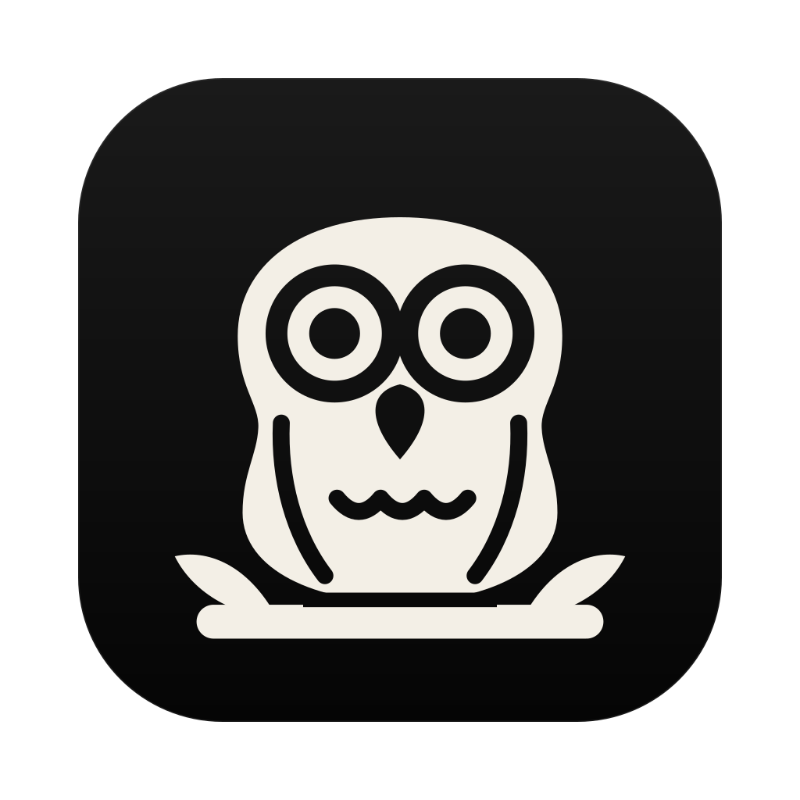

<p align="center"></p>

# Owlery

*[English](./README.md) · 한국어*

**한 번 답하고 돌아오면, 만들지 않은 쪽이 인장을 찍은 PR이 와 있습니다.**

Owlery(아울러리)는 AgenticSeal의 작업 흐름을 바탕으로, 에이전트가 만든 작업에 깨지는 인장을 찍는 데스크톱 앱입니다. 만든 쪽이 아닌 독립된 쪽이 작업을 판정하고, 인장을 커밋 하나에 묶습니다. 그 뒤에 커밋이 하나라도 들어오면 인장이 깨지고, PR을 보는 누구나 그것을 봅니다. 사람은 이슈 하나에 대한 질문에 한 번 답하고 자리를 비웁니다. 그 뒤로 설계, 구현, 리뷰 회차, 판정이 사람 없이 이어지고, 인장이 찍힌 PR이 돌아옵니다.

owlery는 올빼미가 사는 곳을 뜻합니다. 올빼미는 에이전트입니다. Owlery의 엠블럼은 밀랍 없는 올빼미이고, 밀랍 봉인 위의 올빼미는 AgenticSeal이 보증을 나타내는 표시로 남습니다. 자세한 것은 [docs/name.ko.md](docs/name.ko.md)에 있습니다.

## 실행

릴리스 0.0.1은 여기까지 돕니다. 창은 작업함에서 열립니다. 작업마다 자기 브랜치와 자기 worktree가 생기고, 터미널 칸이 그 worktree에서 열리며, 헤드리스 Claude 세션에 질문 하나를 보낼 수 있습니다. 인장은 아직 없습니다. 리뷰 회차와 인장은 [로드맵](docs/roadmap.ko.md#마일스톤)의 마일스톤 2에서 들어옵니다.

macOS, Node.js, pnpm 10.33.0이 필요합니다. 아래 명령은 Node.js 26.13.1로 돌려 보았습니다. 저장소 맨 위에서 실행합니다.

```
pnpm install
pnpm --filter @owlery/desktop start
```

처음 실행할 때 Electron의 바이너리를 내려받고, 그 뒤에 창이 열립니다.

## 문서

| 문서 | 담은 것 |
|---|---|
| [docs/product.ko.md](docs/product.ko.md) | 약속, 누구를 위한 것인가, 인장을 보여 주는 세 자리, 성능 가설과 벤치마크 계획, 일부러 하지 않는 것, 첫 세션 |
| [docs/architecture.ko.md](docs/architecture.ko.md) | 앱, 데몬, 에이전트 어댑터, AgenticSeal 프로세스의 관계, AgenticSeal에서 가져오는 것, 순서와 판단의 분담, 첫 마일스톤의 모양을 정하는 규칙과 v0.1 다음에 오는 것, 메모리 설계, 화면 프레임워크, 만들기 전에 잴 것 |
| [docs/roadmap.ko.md](docs/roadmap.ko.md) | 버전마다 무엇을 어떤 순서로 만들고 언제 끝났다고 보는가. v0.1의 마일스톤 다섯, 그 순서의 근거, 완료 기준, 남겨 둔 결정 |
| [docs/name.ko.md](docs/name.ko.md) | 이름의 뜻과 출처, 발음, 알고 가야 할 것, 엠블럼 |

## AgenticSeal과의 관계

AgenticSeal은 Owlery가 참고하는 원본이고, Owlery는 그것을 넓힌 제품입니다. Owlery는 AgenticSeal 플러그인에 기대어 돌지 않습니다. 원칙, 불변식, 역할, 기록 형식을 가져와 Owlery의 것으로 고쳐 갖고, 순서는 앱의 코드가 실행하며, 역할의 에이전트 정의와 스킬은 앱에 함께 넣어 기본값으로 씁니다. AgenticSeal 플러그인 사용자는 지금처럼 Claude Code에서 그대로 씁니다. 무엇을 어디로 가져왔는지와 기록 형식의 호환은 [docs/architecture.ko.md](docs/architecture.ko.md)에 있습니다.

## 라이선스

Apache License 2.0입니다. 고른 까닭과 다른 프로젝트의 코드를 가져오는 규칙은 [docs/architecture.ko.md](docs/architecture.ko.md#라이선스와-다른-프로젝트의-코드)에 있습니다. Owlery와 AgenticSeal이라는 이름과 올빼미 엠블럼은 이 라이선스의 대상이 아니며, 무엇이 적용되는지는 [TRADEMARKS.md](TRADEMARKS.md)가 밝힙니다.
