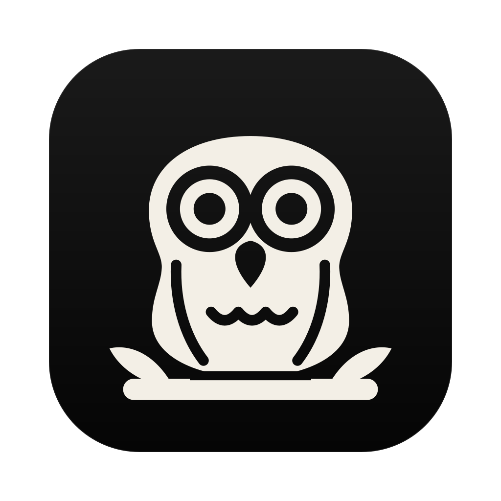

<p align="center"></p>

# Owlery

*English · [한국어](./README.ko.md)*

**Answer once, and come back to a pull request cleared by an AI that did not build it.**

Owlery (OWL-er-ee) is a desktop app that runs IADD on your repositories. A person answers the questions about one issue once and walks away. Design, implementation, review rounds and the inspection then follow without a person, and a pull request comes back carrying an inspection that anyone can read on GitHub.

**IADD, Independent AI-Driven Development, is the method.** Its line is *Zero Self-Approval*: no AI approves its own work. The AIs that frame, craft, proof and inspect the work are independent of one another, and the inspector built none of what it inspects. The inspection is bound to one commit, and a commit that lands after it and changes more than the closing records shows on the pull request as a lapsed inspection. The [IADD specification](https://github.com/MichaelYcJo/iadd-workflows/blob/v0.1.0/spec/iadd.md) defines the method, and [docs/iadd.md](docs/iadd.md) states how Owlery follows it.

**Owlery is one tool that runs IADD, and the Owl Chain is its default workflow.** The Owl Chain is the workflow Owlery ships and keeps up: review rounds by a proofer, fix passes by a crafter, the repository's broad gate, and the inspector's verdict. A Claude Code pane of a repository on the Owl Chain carries it today, and milestone 3 of the [roadmap](docs/roadmap.md#milestones) has Owlery's daemon run it for an issue a person hands over.

An owlery is a place where owls live. The owls are the agents. Owlery's emblem is the owl without the wax, and the owl on red wax is the inspection's mark, which the window draws at a cleared inspection's place. The details are in [docs/name.md](docs/name.md).

## Install

Owlery runs on a Mac with Apple silicon, an M1 chip or later, and macOS 13 Ventura or later. It does not open on an Intel Mac or on an earlier macOS.

1. Download `Owlery-arm64.dmg` from the newest release: <https://github.com/MichaelYcJo/owlery/releases/latest/download/Owlery-arm64.dmg>. Each release's download is on the [releases page](https://github.com/MichaelYcJo/owlery/releases).
2. Open the `.dmg` and drag Owlery into Applications.
3. Open Owlery from Applications.

Until a build is signed with Apple's Developer ID certificate, macOS refuses its first open. The alert says that Apple could not check the app for malicious software, and it offers no button that opens the app. Its wording differs between versions of macOS. To open the app:

4. Open System Settings, click Privacy & Security, and scroll down.
5. Click "Open Anyway" beside the line about Owlery, and confirm with "Open".

Owlery opens on the inbox. It runs your own `claude`, `git` and `gh` through your login shell, so each has to be installed and on the `PATH` your login shell sets.

**Owlery does not update itself yet.** To install a newer version, first choose "Quit Owlery Completely…" from the Owlery menu. That ends Owlery's background process and the sessions it holds. Then download the newer `.dmg` and replace the app in Applications.

## Run it

Release 0.0.1 runs this much. The window opens on the inbox. A work item gets a branch and a worktree of its own, terminal panes open in that worktree, and one question can be put to a headless Claude session. The review rounds and the inspection came with milestone 2 of the [roadmap](docs/roadmap.md#milestones).

You need macOS, Node.js and pnpm 10.33.0. The commands below were run with Node.js 26.13.1. Run them from the top of the repository:

```
pnpm install
pnpm --filter @owlery/desktop start
```

The first start downloads Electron's binary, and then the window opens.

## The inspection check on GitHub

When a repository is connected, Owlery commits a workflow to it, `.github/workflows/owlery-inspection.yml`. On each pull request the workflow runs Owlery's pull request check, which reads the records the work item committed under `agentory/`. The check posts its verdict as a GitHub check named `inspection` on the pull request's head commit. The workflow's own job, `records`, fails where `inspection` fails and passes where it passes or is neutral. A person without the app reads the verdict there, and in the inspection section at the top of the pull request's body, which is a copy of the newest verdict block of the work item's `inspection.md`. A commit pushed after the inspection lapses it, and the check fails until a new inspection is cleared. The check reads the same committed records as the app, and the two judge alike what lands after an inspection the app cleared. Records that no chain of the app commits, written by hand or by another tool, can be judged apart by the two. The title of a cleared and of a lapsed inspection names the Owl Chain where every verdict block the title names holds `workflow: owl-chain`, the line Owlery writes to name the workflow that produced the inspection, and names no workflow otherwise.

| Result of `inspection` | Title | When |
|---|---|---|
| Passed | "Cleared by the Owl Chain at" and the inspected commit, or "Cleared at" and the inspected commit for an inspection of no named workflow | A ready pull request whose head commit carries a cleared inspection, and a draft that would pass once ready |
| Failed | "Inspection of the Owl Chain lapsed: a commit landed after" and the inspected commit, or "Inspection lapsed: a commit landed after" and the inspected commit for an inspection of no named workflow | A ready pull request whose head commit holds an inspection that a later commit lapsed, a merge of the base among them |
| Failed | "Not cleared: no inspection at the head commit" | A ready pull request whose head commit holds no cleared inspection |
| Failed | "The records are refused" | A ready pull request whose records fail another part of the check |
| Neutral | "Draft: judged when it is ready" | A draft that would be refused once ready |
| Passed | "Not judged: no work item is declared" | A pull request that declares no work item |
| Failed | "The inspection check could not run" | The check could not read the checkout or the base branch it is judged against |

**An administrator of the repository makes the check required.** In the repository's rules for the base branch on GitHub, under the rule that requires status checks to pass, the administrator adds `inspection`. Owlery changes no setting of the repository, and the app's dialog "Records and check" says the same. A pull request from a fork gets no `inspection` check, because GitHub gives its workflow run a token that cannot write one, so a required check holds that pull request until an administrator lets it through.

**A repository connected by an earlier Owlery moves to IADD's forms in one commit.** Owlery reads no record of the earlier form and runs no chain on it, and the repository's row says that its records are in the earlier form. The dialog "Records and check" shows the commit that moves the records to `agentory/` in IADD's forms and replaces the earlier workflow with `owlery-inspection.yml`, and writes nothing until the person confirms. An inspection cleared before the move lapses at the move's commit. A rule that required the check the earlier workflow posted has to require `inspection` in its place, since no workflow posts that check after the move. [docs/architecture.md](docs/architecture.md#records-are-committed-to-the-repository) names the earlier forms. A work item's branch that held records before the move moves its own with the chain command's `migrate`.

**The verdict is a check, and never an approving review.** Owlery writes no review and merges nothing. The person merges.

## Documents

| Document | What it holds |
|---|---|
| [docs/iadd.md](docs/iadd.md) | How Owlery follows the IADD specification: its answers to what the specification leaves to a product, where it holds each principle, what it adds to the record forms and where it departs, its check, what a workflow is, and what holds for every workflow |
| [docs/product.md](docs/product.md) | The promise, who it is for, the three places the inspection is shown, performance hypotheses and the benchmark plan, what we deliberately don't do, the first session |
| [docs/architecture.md](docs/architecture.md) | How the app, the daemon, the agent adapters and the Owl Chain fit together, where Owlery started, how order and judgment are split, the rule for the first milestone's shape and what follows the first version, memory design, the screen framework, what to measure before building |
| [docs/roadmap.md](docs/roadmap.md) | What Owlery builds, in what order, and when it is done: the six milestones of the first version, the grounds for their order, the done criteria, and the decisions left open |
| [docs/name.md](docs/name.md) | The meaning and origin of the name, its pronunciation, what to keep in mind, and the emblem |
| [docs/design.md](docs/design.md) | How the window looks and speaks: its principles, the three themes and every value each draws with, the forms of its parts and their states, the voice of its words, what it stays clear of, and the screenshots a pull request that changes the window carries |

## Where Owlery started

Owlery started from [AgenticSeal](https://github.com/MichaelYcJo/AgenticSeal), a Claude Code plugin that runs the same method. On 2026-11-28 the owner set that IADD is the method and a product only expresses it, that the plugin keeps its name `agentic`, and that both tools keep their records under `agentory/` (MichaelYcJo/AgenticSeal#1651, MichaelYcJo/AgenticSeal#1658). Owlery does not run on that plugin. Its role bundle and its pull request check started from the plugin's files and are Owlery's own, and Owlery's code runs the order. What was taken, and the licence of the taken files, are in [docs/architecture.md](docs/architecture.md#where-owlery-started).

## License

Apache License 2.0. Why, and how code from other projects is taken, is in [docs/architecture.md](docs/architecture.md#license-and-code-from-other-projects). The Owlery and AgenticSeal names and the owl emblem are not under that license, and [TRADEMARKS.md](TRADEMARKS.md) states what they are under.
