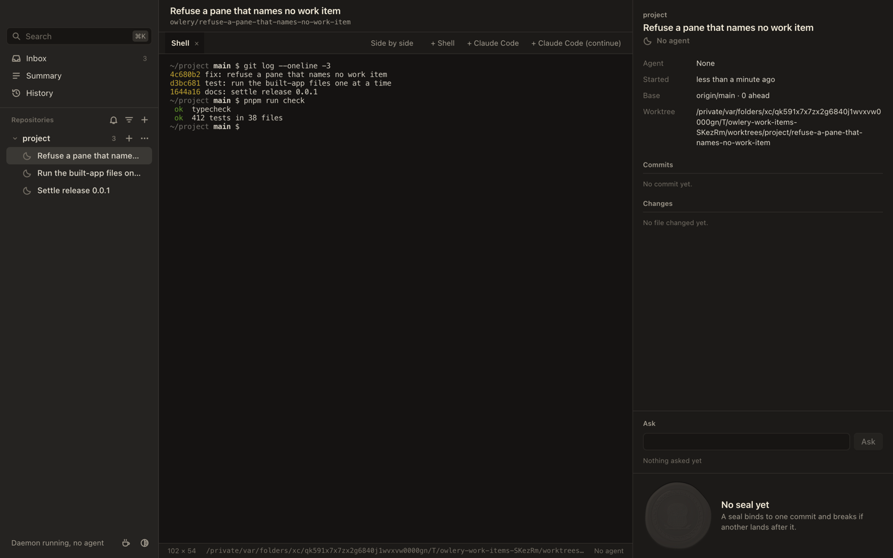
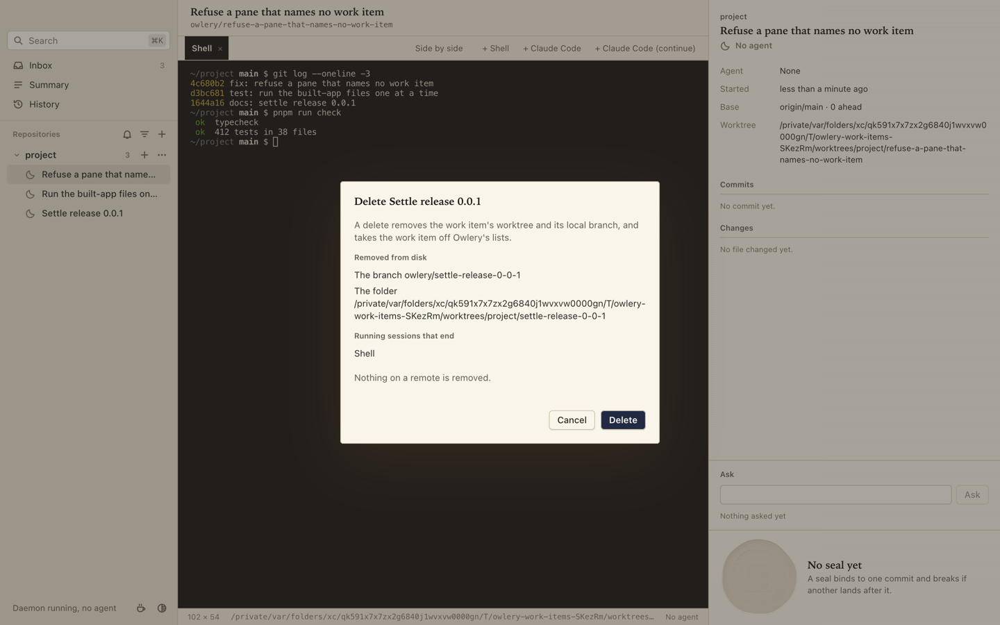
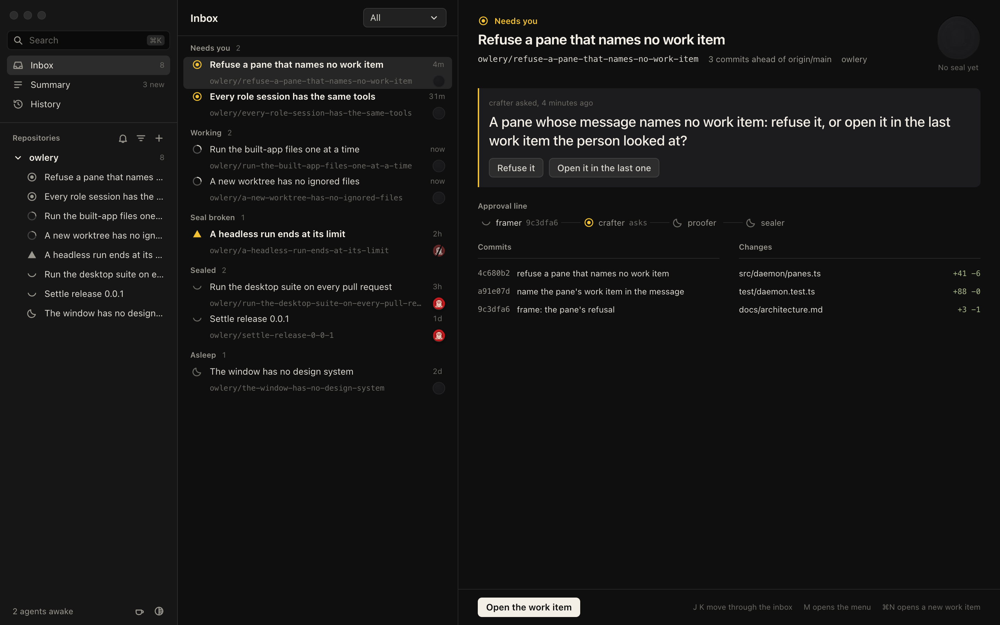
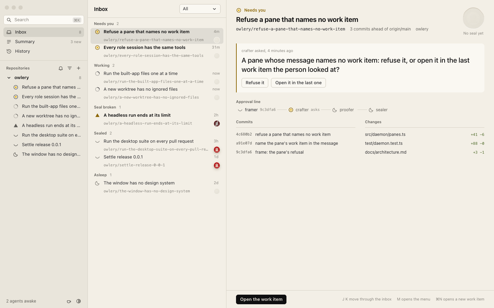
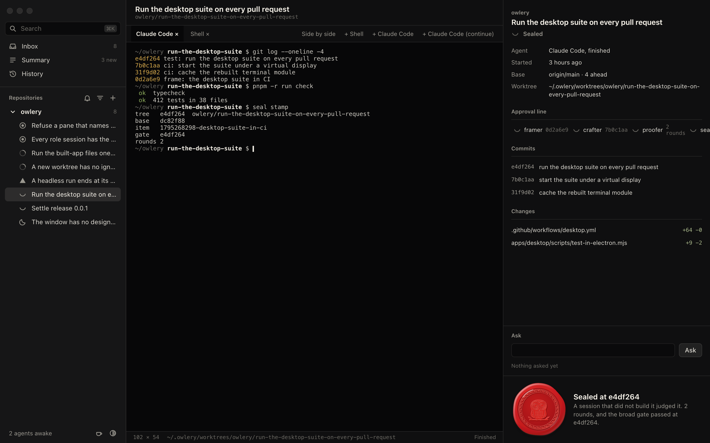
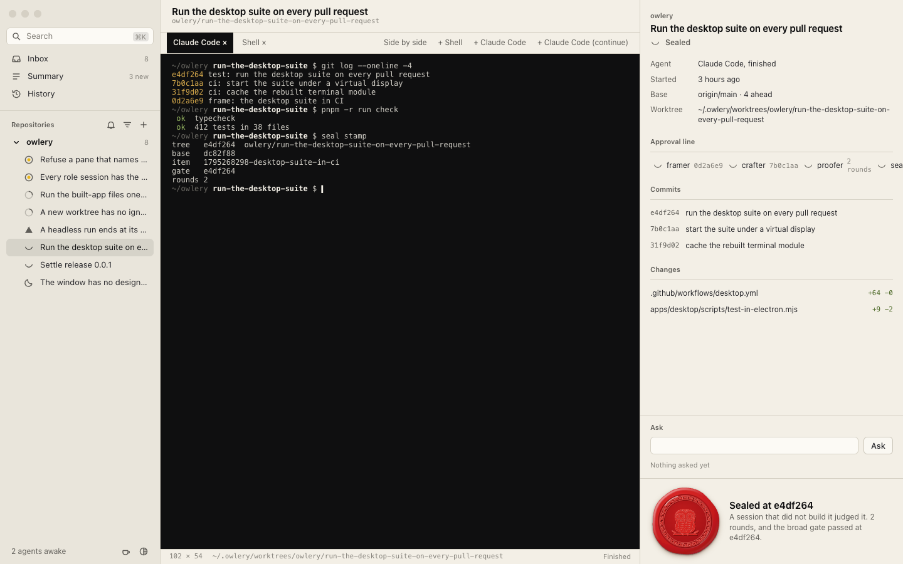
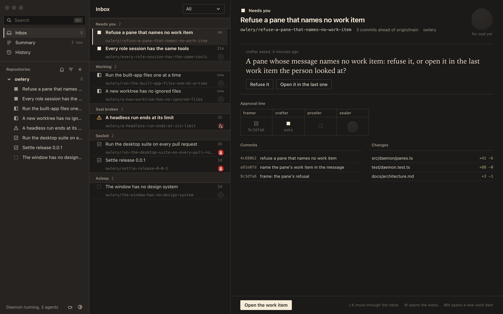
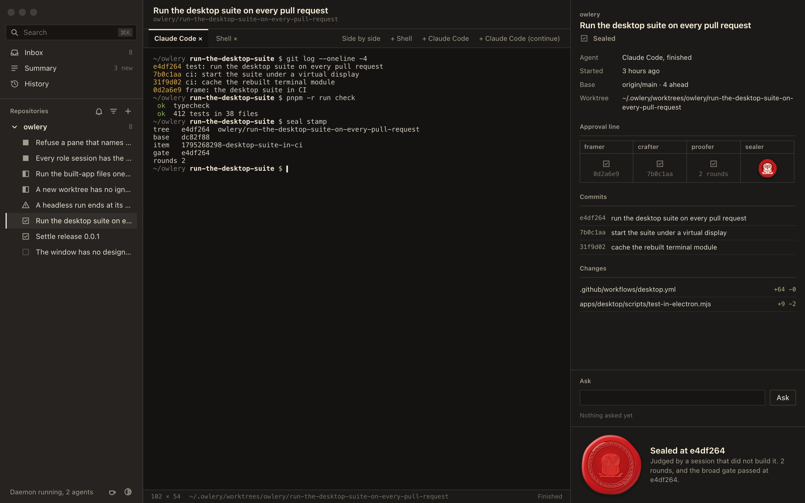
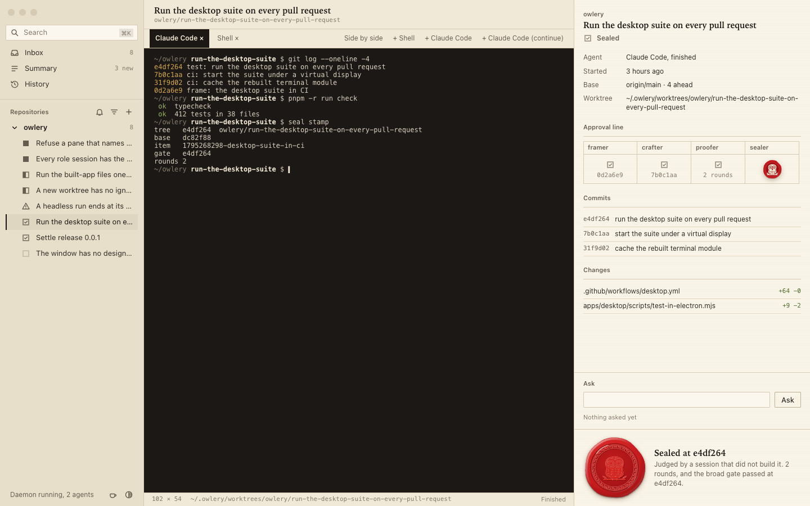
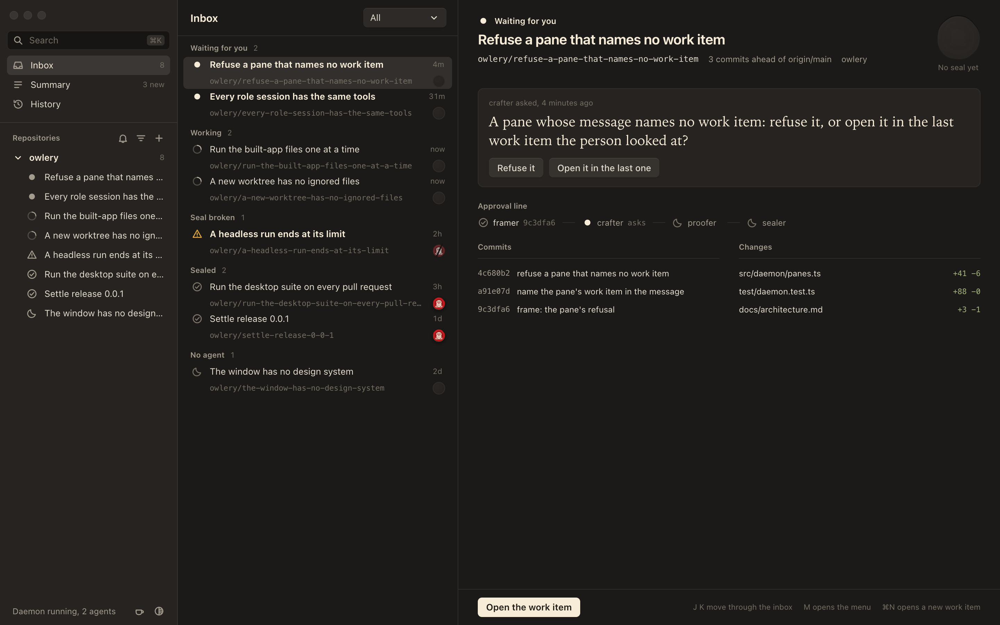

# Design: 1795340000-design-system, the study and the three themes

This file is the study issue #130 asks for first, and the frame of the build that follows it. It reads the window as it stands, names what to avoid, and states the three themes of Owlery's own style. The study put them before the owner as three directions to choose one from. The owner answered row Q1 of `questions.md` on 2026-11-22: B, Night watch, is the default, and A, Register, and C, Desk, are themes a person can choose too. *The themes* and everything under it are written to that answer.

## Grounding

The tree as read at `0d65470`.

| Policy clause | What it fixes for this work |
|---|---|
| `docs/product.md` *The seal belongs to the product and looks the same everywhere*, last paragraph | A theme changes colours, typefaces, texture and how the seal is lit. No theme changes the layout, the words, the seal's drawing or the wax's red. Red stands on the seal alone, and a button, a mark and a failure take another colour. The window has two themes, Night desk and Letter. Read. This is the rule as it stands at this commit. Register and Night watch change the form of edges, rules and marks, which this rule does not let a theme change, so the owner's answer needs the rule rewritten, and *Scope* item 2 rewrites it. |
| `docs/product.md` *Foundation* | The window opens on the inbox, a work item shows its state on one line, and the app stays light. A theme that needs a web typeface, an illustration set or a blur costs memory or disk the product does not spend. Read. |
| `docs/product.md` *The seal* | The seal shows in three places: an approval line per work item (framer, crafter, proofer, sealer), the seal on the pull request, and the back of the seal. The mock-ups draw the approval line and a lit seal from this clause. The app draws neither yet. Read. |
| `docs/product.md` *Who it is for* and *What we deliberately don't do* | The audience works in a terminal. The desktop has no chat screen, no kanban board, no built-in browser, no team screens, and the product makes no throughput claim. A chat bubble or a prompt box in the window would draw what the product refuses to be. Read. |
| `docs/name.md` *Why this name* and *What to keep in mind* | The emblem is a warm white owl on a black rounded square with no red. The owl on red wax is the seal, drawn at a seal's place and nowhere else. The window borrows no image from the Harry Potter books, such as an owl carrying a letter. Read. |
| `apps/desktop/src/renderer/themes.css` | Two blocks, `night-desk` and `letter`, each of 66 custom properties named by role. Executed: `awk '/^:root\[data-theme="night-desk"\]/{f=1} /^:root\[data-theme="letter"\]/{f=2} /^  --/{c[f]++} END{print c[1], c[2]}' apps/desktop/src/renderer/themes.css` printed `66 66`. The issue's count of 133 was not reproduced. |
| `apps/desktop/src/renderer/index.html` lines 10 to 63 | The layout's measures stand in the page's own `:root`: seven sizes of type from 11px to 34px, eleven steps of space from 2px to 44px, the heights and widths of the parts, and `--motion: 120ms`. No theme holds them. Read. |
| `apps/desktop/test/themes.test.ts` | Eight cases hold the look's rules as text: one block per theme, no red outside the properties that open `--seal-`, the same names in every block, no measure in a theme, and no colour, shadow, gradient or corner written outside a theme. The build adds blocks and names, and these cases keep holding for every block. Read. |
| `apps/desktop/src/renderer/shared.ts` line 193 | The mark of a work item that waits for the person is a speech mark, the outline of a chat bubble. Read. Every theme replaces it (*What to avoid*, item 3). |
| The earlier study of the window's finish, 2026-11-19, in the main clone's `etcs/design/polish-mockups/README.md`, not committed | It began from the owner's words that the window "looks like a prototype made with AI". It diagnosed the marks *What to avoid* item 6 lists and fixed them in four variants. Night desk as it stands holds variant 3's values and Letter holds variant 4's: the grounds `#1c1a18` and `#f1e9d8`, the inks, the radii 8, 6, 6, 4 and 4, 5, 5, 3. Read, the values compared with `themes.css` by eye. That study left two things open: where the emblem stands in the window, and whether a failure is ochre. The second is settled by the theme rule above. This study does not argue the choice of variants 3 and 4 again: they stay, as the theme Desk. |
| The main clone's `etcs/research/brand.md`, not committed | It is the search for a personal brand's domain name, settled on Arizelos. It states nothing of colour, type or the window. Read: its headings whole, and a search for the words of colour, type, logo and theme. The study takes nothing from it. |
| The main clone's `etcs/research/competitors/orca.md`, `conductor.md`, `claude-code-desktop.md`, not committed | Each analyses what the product does, who runs it and what it costs. None describes the product's look. `conductor.md` records the market's view that Conductor's design and feel are the best of the field. Read by a search for the words of look and layout, not whole. The look of the nearest products is therefore read from their public pages, in the next row. |
| The public pages of the nearest products, opened 2026-11-22 | `https://www.orca.dev/`, `https://www.conductor.build/`, `https://linear.app/`, `https://cursor.com/` and `https://code.claude.com/docs/en/desktop`, five pages. Executed: one headless Chrome run each, `--headless=new --window-size=1440,2400 --screenshot`, and each capture read. The captures stand in the framer's scratch directory and are not committed, because they are other companies' pages. No product's app was installed or run, so what an app looks like past its own front page is unverified. |
| The window as it stands | Executed: a probe `test_tmp_shots.test.ts`, run once from a `git clone --no-local` of this branch in the framer's scratch directory with the main clone's installed modules linked in, through `apps/desktop/test/built-app.ts` with `OWLERY_BACKGROUND=1`. It built the app, created three work items in a temporary clone, and captured each screen with `Page.captureScreenshot` in both themes. The run exited 0. The captures *The window as it stands* shows are under `images/` as `as-is-*.png`, scaled to 1440 by 900. |
| Issue #130 | Its body is the request this study answers. It has no comment. Executed: `gh issue view 130 --json title,body,comments`. |
| `seal/threads/1795340000-design-system/routing.md` | Present. It routes the work through a framer, a crafter and the review chain, and names the choice of a direction as the one question for the owner. Read. |
| `seal/follow-up.md` | Absent. Executed: `ls seal/` lists `config.json`, `README.md` and `threads`. |
| The latest GitHub Release, `v0.0.1` | Its body holds no `### Process changes` heading. Executed: `gh release view --json tagName,body`. |
| Nothing in the tree takes a screenshot | Executed: `git grep -n captureScreenshot -- apps` at `0d65470` printed nothing. The search can fail: the probe's own file holds the word, in the scratch clone. |
| `apps/desktop/src/shared/appearance.ts`, `src/main/appearance.ts`, `src/preload/preload.ts`, `src/renderer/theme.ts` | A person chooses one of Night desk, Letter and Match the system in one control at the sidebar's foot. The main process keeps the choice in `appearance.json` as `{"theme": …}` and opens the window on the theme's ground, the preload puts `data-theme` on the page before it is drawn, and the page changes that one attribute. A choice that is none of the three reads as Night desk. Read. |
| `apps/desktop/src/renderer/view.ts` lines 116, 117, 593 and 1423 | The states' words are "Waiting for you", "Working", "Finished" and "No agent", a notification's body is "Waiting for you" or "Finished", and the status line is "Daemon running, " with the count of agents. Read. |
| No selector names a theme outside `themes.css` | Executed: `git grep -n -e '\[data-theme' -e '\[data-appearance' 9efbc74 -- apps/desktop/src/renderer/index.html 'apps/desktop/src/renderer/*.ts'` printed nothing and exited 1. The search can fail: a rule of the page's style that opened `:root[data-theme=` would print. |
| No unsettled design changes `docs/product.md` | Executed: `git grep -n 'file: docs/product' 9efbc74 -- 'seal/threads/*/frame/design.md'` printed nothing. |
| The page uses no blur | Executed: `git grep -n -c backdrop-filter -- apps/desktop/src` at `0d65470` exited 1 and printed nothing. |

## The window as it stands

| Screen | Night desk | Letter |
|---|---|---|
| The inbox |  |  |
| A work item's view |  |  |
| A work item's menu |  |  |
| A dialog |  |  |

What the captures show, read against the policy above.

- **What already is Owlery's own.** The seal's place is pressed blank into the ground before a seal, at the right of each line, in the preview and at the foot of a view. The words are whole sentences that say what will happen and name the thing: "A delete removes the work item's worktree and its local branch", "Nothing on a remote is removed", "A seal binds to one commit and breaks if another lands after it". The hints name keys in a sentence: "J K move through the inbox". No red stands anywhere but the seal.
- **What is nobody's choice.** A line, a menu's item and a sidebar's item are each a rounded tile that fills on hover, the form most desktop tools of 2026 share. A menu and a dialog are a rounded card with a wide soft shadow. A button is a rounded tile. None of these forms is stated anywhere, so each work item drew its own.
- **Where the window sits beside its neighbours.** Night desk is a warm brown-black with cream ink, and Letter sets its titles in a serif on cream paper. The Claude Code documentation page and Cursor's front page, opened for this study, draw on the same warm dark ground with cream ink, and Claude's page sets its titles in a serif. Without the seal on screen, the window's ground and ink are theirs.
- **What an empty work item shows.** No work item can be sealed yet, so every seal's place is blank and every state in the captures is "No agent". The mock-ups below fill the states that `docs/product.md` names, so a theme is judged on the screen a person will use.

## What to avoid

### The marks of a generic AI product

1. **Purple, and gradients of purple into blue or pink.** A violet glow behind a panel, a gradient across a headline or a button. Owlery's only saturated colour is the wax's red, and it stands on the seal alone.
2. **Sparkles.** A four-pointed star beside a word to say that a model does it. The Claude Code documentation page carries one on its "Ask Assistant" button (opened 2026-11-22). Owlery marks nothing as made by a model: every line of the inbox is an agent's work, so the mark would say nothing.
3. **Chat bubbles and the prompt box.** A transcript of rounded bubbles over a box that says "Ask anything", with a model's name on a chip under it. Orca's, Conductor's and Cursor's front pages each show their app as that screen (opened 2026-11-22). `docs/product.md` refuses a chat screen on the desktop. The window's own mark for a wait is a speech mark today (`apps/desktop/src/renderer/shared.ts` line 193), and every theme replaces it.
4. **Glass.** A translucent panel that blurs what is behind it. The page uses no blur today, and a theme adds none: a blur costs the graphics process memory the product measures.
5. **Rounded everything.** Buttons and fields as full pills, cards with corners of 12px and more, round avatars. Linear's "Sign up" and Cursor's download buttons are pills (opened 2026-11-22). A theme states one small scale of corners and uses a circle only for what is round in the world: the seal and a state's mark.
6. **The eight marks the study of 2026-11-19 diagnosed in this window.** A blue slate ground with amber and sky accents. Inter, Space Grotesk and JetBrains Mono. Labels in tracked capitals. A 30px title over 68px lines and 44px buttons. An empty preview. One radius of 8px and one 1px edge on everything, with a dashed circle for the seal. A logo's row of its own under the traffic lights. No hover, no motion, no icon of a state. The window as it stands has none of them, and `docs/design.md` names them so that none returns.
7. **Words that sell.** "Magic", "supercharge", "100x", an exclamation mark, a greeting from the agent in the first person, an emoji in a label. Orca's front page opens with "Ship 100x with the agent IDE" (opened 2026-11-22), and `docs/product.md` refuses throughput claims.

### The patterns of the nearest products

What each page showed on 2026-11-22. Each row names the pattern to stay clear of, and a row says so where the pattern is close to what the window draws today.

| Product | Source | What its page draws | What Owlery does not take |
|---|---|---|---|
| Orca | `https://www.orca.dev/` | A cool near-black ground, a white grotesque headline, a strip of pill tabs. The app is a tree of worktrees with each agent's logo on its row, split panes of chat with a prompt box in each, and a status bar of usage meters. | The agents' brand logos as row icons, the prompt box, the bar of meters, the claim of speed. |
| Conductor | `https://www.conductor.build/` | A black ground under a field of pixel stars and ASCII figures, and a pixel logo. The app is a sidebar of workspaces, a chat transcript in the middle, and a right column of changed files with green and red counts under a green "Merge" button. Team members' round photographs stand in the sidebar. | The decoration of pixels and ASCII, the green button of a merge, photographs of people. Its right column of commits and changed files is close to the window's own, so the window's column is told apart by the approval line and the seal at its foot. |
| Linear | `https://linear.app/` | A near-black neutral ground, a tight grotesque, a headline whose first sentence is white and whose rest is grey, captions in tracked fixed-width capitals ("FIG 0.1"), figures drawn as isometric hairlines. | The two-tone headline, the tracked capitals, the hairline figures. The look of Linear's app itself was not opened. Unverified. |
| Cursor | `https://cursor.com/` | A warm near-black with cream ink, the app's windows floating over an oil painting of a landscape, an orange for links, pill buttons. | The painting behind a window, the orange. Its warm ground and cream ink are close to Night desk's. |
| Claude Code's desktop app | `https://code.claude.com/docs/en/desktop` | The documentation page: a warm dark ground, page titles in a serif, a terracotta orange for the active item and the eyebrow over a title, the spark logo, a sparkle on "Ask Assistant". The app itself was not opened. Unverified. | The orange, the spark, the sparkle. Its serif titles on a warm ground are close to Letter's serif titles and to the serif of what an agent says in both themes. |

The neighbours fall into two camps. Orca, Conductor and Linear draw in neutral black with a grotesque. Cursor and Claude draw in warm black with cream, and Claude adds a serif. Night desk and Letter stand in the second camp today. No page opened draws a ruled register, an approval line, or a seal.

## The themes

The study put three directions before the owner as A, Register; B, Night watch; and C, Desk. The owner answered on 2026-11-22: "default는 B로 하고 나머지 2개도 우리 고를수있는 theme로 하면되지않아?" Night watch is the theme a first run opens in, and Register and Desk are themes a person can choose. This section states each as the build draws it. Where the study's direction went past what a theme may change, the theme stops at the rule of *Scope* item 2, and *Out of scope* names what was left.

Each mock-up is `images/mock.html` drawn by a headless Chrome, with the layout's measures of the built app. Open it from a checkout as `mock.html?d=<watch|register|desk>&t=<night-desk|letter>&s=<inbox|view>`, where `t=night-desk` is the dark appearance and `t=letter` the light one. The dark images are drawn at twice the size and the light images at the size itself. The work items, commits and terminal lines in it are invented examples. The approval line and the lit seal are drawn from `docs/product.md` *The seal* before the app can show them. The broken seal is a placeholder and no proposal. The Register images and `mock.html` are drawn after the owner's answer. The Night watch and Desk images are the ones the owner chose from, and they differ from the build in three things: the words, the inks, and the failure triangle. Night watch's sidebar foot says "2 agents awake" where the window keeps "Daemon running, 2 agents", and Desk says "Waiting for you" and "No agent" where every theme now says "Needs you" and "Asleep". The muted and faint inks of every theme are drawn lighter in the dark appearance and darker in the light one than the mock-ups have them, because the build raises them to the floor of *What every theme shares*, *Contrast*. Night watch's failure triangle in the light appearance has an edge in the build, which the mock-ups do not draw.

### What every theme shares

- **The layout and its measures.** The columns, the sizes of type, the steps of space, the heights of the parts, and the one duration of motion, 120ms, all of which stand in the page's `:root`. A theme holds no measure, as `apps/desktop/test/themes.test.ts` already checks.
- **The words.** One set for every theme (*The words* below).
- **The seal.** Its drawing and the wax's red. The blank place is pressed into the ground in the theme's own tones, and a line ends in the seal's place.
- **The system's typefaces.** No theme loads a typeface.
- **Red on the seal alone, and a failure that is not red.**
- **No speech mark.** No theme draws a wait as a chat bubble.
- **A dark and a light appearance.**
- **Contrast.** Words stand at 4.5 to 1 or more against the ground under them, and at 3 to 1 where they are 24px or more, or 18.66px or more in a bold weight. A state's mark and the ring of the keyboard's focus stand at 3 to 1 or more against the ground around them. A value that falls under a floor is raised in every theme, Desk's among them. Two things stand outside the floors: a ground drawn only while a part is pressed, which lasts as long as the press and the part's words were read before it, and a disabled button, which the window draws at 45% of its strength.

### What each theme is

| | B. Night watch, the first run's | A. Register | C. Desk |
|---|---|---|---|
| The idea | The window is drawn from the emblem, a white owl on black, and the owl's yellow eye is the one colour that says a work item needs the person. | The window is the register where sealed work is entered, so it is drawn as a ruled book of records and the seal is the one thing on it that is not ink. | The window as it stood before this work: a warm desk at night and a sheet of letter paper. |
| Palette, dark | Grounds `#0f0f10`, `#161617` for the sidebar and `#1c1c1e` raised, from the icon's black. Inks `#f3efe6`, the icon's owl, then `#dcd9d1`, `#a3a097`, `#908e87`. The signal is the eye's yellow, `#f2c033`. The values stand in `docs/design.md`. | The block `night-desk` as it stands at `0d65470`, with `--rule` at 13% of the cream and `--rule-soft` at 7%, because the rules carry the structure, and with the muted and faint inks raised to `#aea697` and `#9b9385`, the words of a finished and a sleeping work item to `#a39b8c` and `#9b9385`, and `--removed` with the muted ink. | The block `night-desk` as it stands at `0d65470`, with the muted and faint inks raised to `#aea697` and `#9b9385`, the words of a finished and a sleeping work item to `#a39b8c` and `#9b9385`, and `--removed` with the muted ink. |
| Palette, light | The same two turned over: ground `#f3efe6`, inks `#0f0f10`, `#26262a`, `#53514d`, `#62605c`. The signal is `#846000` for words over a fill of `#e9b61a`. | The block `letter` as it stands, with the main button in the ink `#1a1613` in place of ink blue, so a page holds one ink, and with the muted and faint inks darkened to `#564d43` and `#655c51` and the failure's ochre to `#8f550b`, the words of a finished and a sleeping work item to `#655c51`, and the working mark and `--removed` with the muted ink. | The block `letter` as it stands, with the muted and faint inks darkened to `#564d43` and `#655c51` and the failure's ochre to `#8f550b`, the words of a finished and a sleeping work item to `#655c51`, and the working mark and `--removed` with the muted ink. |
| The signal colour | The yellow, on what needs the person: a waiting mark, the edge of a question, a failure. Its red exceeds its green by 50 of 255, inside the margin of 80 under which `themes.test.ts` reads no red. | The strong ink, and the ochre for a failure. | The strong ink, and the ochre for a failure. |
| Type | The system's sans alone, and the fixed-width face for a branch and a commit. No serif: what an agent says is set in the sans. | The sans for words, the fixed-width face for every fact a person compares down the list (a branch, a commit, an age, a count), and the serif where Desk has it. | The sans, the fixed-width face for a branch and a commit, the serif for what an agent says and the summary's sentence, and in the light appearance for titles. |
| Corners | 8, 6, 6, 4 for a card, a control, a line and a chip, in both appearances. | 2, 2, 0, 0. | Dark 8, 6, 6, 4. Light 4, 5, 5, 3. |
| Edges and rules | A line is a tile with no edge. | A rule under each row of a list of records: a line of the inbox, and a work item's commits, its changed files and its facts in a view. The sidebar's items are navigation and carry none. A group's head is a ruled band on the sidebar's ground, a button is drawn by its edge with no fill, and a question is set between two rules. | A line is a tile with no edge. |
| Selected | A tinted tile. | A 2px rule of the strong ink at the left edge, and a faint ground. | A tinted tile. |
| Texture | None, in both appearances. | None in the dark appearance, the ruled paper in the light one's right column. | None in the dark appearance, the ruled paper in the light one's right column. |
| Marks of a state | The owl's eye. An open eye with its pupil, in the signal colour, needs the person. A ring that turns is at work. A closed eye is finished. A crescent is asleep. A filled triangle in the signal colour is a failure, and in the light appearance it has an edge of the darkened yellow, because the bright fill alone does not stand apart from the ground. | A form's boxes. A filled box needs the person, a half-filled box is at work, a ticked box is finished, an empty box is asleep, and the ochre triangle is a failure. | A filled disc in the strong ink needs the person. The ring that turns, the ticked circle, the crescent and the ochre triangle are as they stand. |
| The seal and the owl | The seal's red is the only warm colour on a neutral page. The owl appears a second time, as the eye of the marks. | The seals of the inbox stand under one another down the list's right edge. The approval line is a ruled block of four boxes, one for each of framer, crafter, proofer and sealer, and the sealer's box holds the seal. The owl appears in the seal alone. | The seal as it stands, and the approval line as a row of the roles' names joined by short rules. The owl appears in the seal alone. |
| What it costs | Yellow is the colour most tools use for a warning, so a work item that needs the person may read as a fault, and a failure and a wait share the colour and differ by shape alone. | It reads colder than Desk, and the serif of what an agent says is what keeps it from reading as a spreadsheet. | It is the nearest of the themes to Claude's and Cursor's pages: a warm dark ground, cream ink, and in the light appearance a serif title. |
| Who else draws this | The neutral black ground with a grotesque is the camp of Orca, Conductor and Linear. The eye's yellow and the eye marks are on none of the pages opened. | None of the pages opened draws a ruled register, an approval block or a seal. | The warm ground and cream ink: Cursor and Claude. The serif titles: Claude. |

### The mock-ups

| Theme | The inbox, dark | The inbox, light | A work item's view, dark | A work item's view, light |
|---|---|---|---|---|
| B. Night watch |  |  |  |  |
| A. Register |  |  |  |  |
| C. Desk |  |  |  |  |

### The words

No theme changes a word, so Night watch's words become the window's in every theme. Two states change their words, and the change reaches every place the window names the state, in `apps/desktop/src/renderer/view.ts`.

| The window says today | It will say | Where it is said |
|---|---|---|
| "Waiting for you" | "Needs you" | The waiting state's words wherever the window names the state: a line's state, an inbox group's head, the state with its age as in "Needs you, 12 min", the summary's sentence ("1 needs you, 2 working"), a change's sentence ("Needs you."), the hint "Enter opens the first that needs you.", the bell's label ("2 need you. Show them alone.") and a notification's body |
| "No agent" | "Asleep" | The words of a work item with no agent: a line's state, a group's head, and the strip under a view's panes |

"Working" and "Finished" stay. A sentence that says what runs and not what a state is called stays: "No agent is running." in a change's sentence. The sidebar's status line stays "Daemon running, 2 agents", count included: the study's "2 agents awake" is not taken, because the line reports the daemon, which a person acts on when it is not running, and "awake" would stand beside "keeping the Mac awake" in the same line. Every other sentence of the window stays as it stands, and `docs/design.md` states the voice they share: whole sentences that say what happens and name the thing, no exclamation mark, no first person, no word that sells.

### The names, and how a person chooses

- **A theme is one of three: Night watch, Register, Desk.** "Theme" is the owner's word in the answer and `docs/product.md`'s word, so it keeps naming what a person chooses for the look.
- **An appearance is dark or light, and a person chooses Dark, Light or Match the system.** The names "Night desk" and "Letter" leave the window. Each named one theme in one appearance, and under three themes they would name Desk's two appearances only, while Night watch's light appearance has neither the paper nor the serif that "Letter" says. "Appearance" is macOS's own word for dark and light, and `apps/desktop/src/shared/appearance.ts` already says "the system's appearance".
- **Two controls at the sidebar's foot.** The control that chooses the theme today, `#theme` in `#theme-control`, offers the three themes. A second control of the same form beside it offers Dark, Light and Match the system. One list cannot hold a choice on two axes, and a list of every pair would hide that the appearance can follow the system under any theme.
- **The page carries both.** `data-theme` on the page's `html` names the theme as `night-watch`, `register` or `desk`, and `data-appearance` names `dark` or `light`. `themes.css` holds one block for each pair.
- **A person's earlier choice maps to Night watch in the same appearance.** `appearance.json` holds `{"theme": …, "appearance": …}`. A file of the earlier form, whose `theme` is `night-desk`, `letter` or `system`, is read as Night watch in the dark appearance, the light one, or the system's. A file that holds neither form, and no file, is Night watch in the dark appearance, as a first run opens in the dark Night desk today.

## Scope

In scope, by number. `frame/plan.md` cites these numbers.

1. **The study.** This document, its screenshots and its mock-ups under `images/`. It is done at the frame.
2. **The rule of a theme is rewritten in `docs/product.md` and `docs/product.ko.md`.** The last paragraph of *The seal belongs to the product and looks the same everywhere*, and of its Korean section, becomes: "The app has themes, and a theme changes colours, typefaces, texture, how the seal is lit, and the form of edges, rules and marks. No theme changes the layout, the words, the seal's drawing or the wax's red, and in every theme red stands on the seal alone: a button, a mark and a failure take another colour. The window has three themes: Night watch, which a first run opens in, Register and Desk. Each has a dark and a light appearance, and a person chooses one or lets the system's appearance choose. [docs/design.md](design.md) states each theme." A `check:` line under it names `apps/desktop/test/themes.test.ts` and `apps/desktop/test/appearance.test.ts`.
3. **`docs/design.md` and `docs/design.ko.md`.** The principles, contrast among them (*What every theme shares*); what every theme shares; each theme's idea; the tokens, as one table for the layout's measures and one table for each theme whose columns are the token, its value in the dark appearance and its value in the light one; the components and their states (a button, a line of the inbox and of the sidebar, a group's head, a menu, a dialog, a field, a tab, a state's mark, the seal's place, the approval line; and for each the resting, hover, pressed, selected, focused and disabled states it has); the voice of the window's words; what to avoid, from *What to avoid* above; and the rule of item 9. `README.md` and `README.ko.md` gain the document's row in their table of documents.
4. **A person chooses a theme and an appearance.** `apps/desktop/src/shared/appearance.ts` names the three themes and the three choices of appearance. The main process keeps both in `appearance.json` and reads the earlier form as *The names, and how a person chooses* states. The preload puts `data-theme` and `data-appearance` on the page before it is drawn. The main process opens the window on the ground of the pair, so `GROUNDS` of `apps/desktop/src/main/appearance.ts` holds one ground for each pair. The sidebar's foot holds the two controls. A first run opens in Night watch, in the dark appearance.
5. **`themes.css` holds one block for each theme in each appearance, and every difference between two themes is a custom property of their blocks.** The rule under a line, the edge of a selected line, a group's ground, the typeface of a fact and the shape of each mark are properties a block defines, and the page's style reads them. No selector of `index.html` and no module of the renderer names a theme or an appearance, so a theme is its blocks alone. Desk's two blocks draw the window as it stands at `0d65470`, but for the mark of a wait and the colours raised to the contrast floor: `--ink-muted`, `--ink-faint`, `--state-finished`, `--state-no-agent` and `--removed` in both appearances, and in the light one `--state-working` and `--state-failed`.
6. **The tokens have one source.** Every property of every block of `themes.css`, and every measure of the page's `:root` in `index.html`, is a token `docs/design.md` names with that value, in both editions, and a case of the suite fails where they differ, for each theme in each appearance.
7. **A state's marks are the theme's, and none is a speech mark.** The shapes leave `apps/desktop/src/renderer/shared.ts#STATE_SHAPES` for the theme's blocks, as properties whose values are paths. The probe below showed that a path takes its shape from a custom property in the app's Electron.
8. **The states' words of *The words* change wherever the window names a state, and a case pins each place.** The places are the table's third column.
9. **The screenshot step.** One command of `apps/desktop` writes the screenshots of the inbox, a work item's view, a menu and a dialog through `apps/desktop/test/built-app.ts`, for Night watch in both appearances, and for the other themes where it is asked for them. `docs/design.md` states that a pull request that changes the window carries the screenshots of the views it changed in Night watch, dark and light, and in each other theme that draws the changed part differently, and that its review reads them against the document. This pull request carries the inbox and a view in every theme and appearance, and the menu and the dialog in Night watch.

Out of scope, each with its reason.

- **The layout.** The columns, their order and the sidebar's items were chosen in issue #18, and no theme changes them.
- **The study's columns of a line under Register.** The study drew a count of commits ahead and an age as columns of their own, with a line as wide as the list. Those move measures of the layout, which no theme changes, so Register keeps the line's parts where every theme has them.
- **A motion, or a word, of a theme's own.** The study gave Register no motion on hover, Night watch 160ms and a blink of the waiting mark, and each direction a voice. The rule of item 2 lists what a theme changes, and neither a duration nor a word is in it.
- **A fourth theme.** The owner named three.
- **The seal's drawing, the wax's red, and the drawing of a broken seal.** The first two are AgenticSeal's and policy fixes them. The third belongs to the milestone that builds the seal.
- **The approval line and a lit seal in the app.** No work item can be sealed yet. `docs/design.md` states their form in each theme, and the milestone that builds the seal draws them.
- **A web typeface, an illustration, a blur.** Each costs what `docs/product.md` *Foundation* says the app does not spend.
- **The app's icon, the README's emblem, the phone, a website.** The issue asks for the window.

## User scenarios & acceptance *(mandatory)*

| Scenario | Given / When / Then | Verifiable how |
|---|---|---|
| A first run | Given no saved choice. When the window opens. Then it is drawn in Night watch, in the dark appearance, on that pair's ground from its first frame. | Cases of `apps/desktop/test/appearance.test.ts` on the choice read from no file and on the ground at start. |
| A person who chose before | Given `appearance.json` of the earlier form with `letter`, `night-desk` or `system`. When the window opens. Then it is drawn in Night watch in the light appearance, the dark one, or the system's. | A case of `apps/desktop/test/appearance.test.ts` for each of the three values, seen red against a reader that maps the earlier `night-desk` to the light appearance, and against one that does not read the earlier shape (for `letter` and `system`); `night-desk` is read as Night watch dark, which is also the first run's choice. |
| A person changes the theme | Given the window in Night watch. When the person chooses Register, then Desk, in the theme's control, and Light in the appearance's control. Then the page's `data-theme` and `data-appearance` follow at once, the terminals take the new colours, the choice is saved, and the next window opens in it. | A case that drives the two controls in the built app and reads the two attributes and the saved file. |
| No word and no measure moves with a theme | Given any two themes. When the window is drawn in each. Then every text and every box's size is the same. | The existing cases of `apps/desktop/test/themes.test.ts` that a block defines no measure and only custom properties, for every block; and `git grep -n -e '\[data-theme' -e '\[data-appearance' -- apps/desktop/src/renderer/index.html 'apps/desktop/src/renderer/*.ts'` prints nothing. |
| A person reads the system | Given the themes. When a person opens `docs/design.md` or `docs/design.ko.md`. Then it states what item 3 of *Scope* lists. | Both files exist with the same count of headings and of table rows, which the `Broad gate` command of `seal/config.json` checks for every document of `docs/`. The orchestrator runs it. |
| A theme's value drifts from the document | Given `docs/design.md` names a token's value for a theme and an appearance. When that block of `themes.css`, or the page's `:root`, holds another value or a property the document does not name. Then a case of the suite fails and names the token and the block. | A case in `apps/desktop/test/themes.test.ts`, seen red with one value of one block changed. |
| Something needs the person | Given a work item whose agent waits. When the inbox draws its line. Then its state says "Needs you", and its mark is the theme's and no speech mark. | Cases of `apps/desktop/test/view.test.ts` on each place *The words* names for "Needs you" and "Asleep", each seen red against the earlier text; and a case of `apps/desktop/test/themes.test.ts` that every block defines a shape for each state. |
| Red stands on the seal alone | Given every block. When the suite reads `themes.css`. Then no property outside the ones that open `--seal-` holds a red. | The existing case "holds a red in no property but the seal's" of `apps/desktop/test/themes.test.ts`. |
| A pull request that changes the window shows it | Given a branch that changes a view. When its builder runs the screenshot command. Then a PNG file is written for each screen item 9 names, in Night watch's two appearances, and in the other themes where the command is asked for them. | The command exits 0 and writes those files, and this work item's own pull request body shows the ones item 9 names for it. |

## Data & interfaces

- `docs/product.md` and `docs/product.ko.md`: the paragraph of *Scope* item 2.
- `docs/design.md` and `docs/design.ko.md`: new policy documents. The token tables are what item 6's case reads.
- `apps/desktop/src/shared/appearance.ts`: `THEMES` becomes the three themes, and the choices of appearance stand beside them. What a person chooses is a theme and one of `dark`, `light`, `system`.
- `appearance.json` in the app's user data folder: `{"theme": "night-watch" | "register" | "desk", "appearance": "dark" | "light" | "system"}`. The earlier form `{"theme": "night-desk" | "letter" | "system"}` is read and never written.
- `apps/desktop/src/shared/ipc.ts`, `src/preload/preload.ts`, `src/main/main.ts`, `src/main/appearance.ts`, `src/renderer/theme.ts`: the channel, the two attributes, the six grounds and the two controls.
- `apps/desktop/src/renderer/themes.css`: six blocks, each selected by `:root[data-theme="…"][data-appearance="…"]`.
- `apps/desktop/src/renderer/index.html`: the second control in the sidebar's foot, and the style's reading of the new properties.
- `apps/desktop/src/renderer/shared.ts`: a state's icon is drawn as paths whose shapes the theme gives.
- `apps/desktop/src/renderer/view.ts`: the states' words, in each place *The words* names.
- `apps/desktop/package.json`: one script that runs the screenshot case, beside `korean:typed`, `measure:memory` and `role:run`.
- `images/mock.html` of this work item: the mock-ups' source, which holds each theme's values as custom properties under `:root[data-d="…"]`. Phase 1 took its values into `docs/design.md`, naming the properties that carry the form and filling what the mock-ups lack (`trail/phases/phase-1.md` *Decisions*); from then on `docs/design.md`'s tables are the source the build reads, and the mock-ups are a picture of the study.

Two probes stand under these interfaces. Each ran in the built app at `9efbc74`, whose tree outside this work item's directory is `0d65470`'s, through a probe `test_tmp_cost.test.ts` in the framer's scratch clone. Its first run failed on the probe's own reading of the style sheet and measured nothing, and its second exited 0.

- **What four more blocks cost.** Executed. Two more copies of `themes.css`, 15,036 bytes and four rules, were added to the running window. The renderer process's footprint, read six times a second apart with macOS's `footprint`, was 27.25 MB before, 27.64 MB at the first reading after and 25.77 MB at the five that followed, so the blocks' cost is below what the process moves by on its own. Parsing them and computing the page's style again took 7.9 ms. Moving the page to another block and laying it out again took 46.6 ms.
- **A mark's shape as a property.** Executed, in Electron 45.3.3. A `path` whose style is `d: var(--probe-shape)` took the shape `path("M0 0L10 0")` from the page's root, and its box followed when the property changed to `path("M0 0L30 0")`: its width read 10, then 30.

## Rule changes

- nothing
  why: The work item's subject is the policy root. Its pull request writes the paragraph of *Scope* item 2 into `docs/product.md` and `docs/product.ko.md` directly, and adds `docs/design.md` and `docs/design.ko.md`. No unsettled design holds an operation on `docs/product.md`, so none is re-pointed.

## Removes

| Removes | Coordinate | Where it lands, or why it can go |
|---|---|---|
| The rule that a theme changes colours, typefaces, texture and the seal's light and nothing else, and the sentence that the window has two themes, Night desk and Letter | `docs/product.md` *The seal belongs to the product and looks the same everywhere*, last paragraph, and the same paragraph of `docs/product.ko.md` | The paragraph of *Scope* item 2 replaces both. |
| The names "Night desk" and "Letter" as what a person chooses, and "Match the system" as a third theme | `apps/desktop/src/shared/appearance.ts#THEME_CHOICES`, and the cases of `apps/desktop/test/appearance.test.ts` that pin them | The three themes' names and the three choices of appearance, pinned by cases of the same file. |
| The blocks `night-desk` and `letter` under those names | `apps/desktop/src/renderer/themes.css` | They become Desk's dark and light blocks, with the same values but for the properties item 5 adds, the mark of a wait, and the inks raised to the contrast floor (*Scope* item 5). |
| The two grounds named by theme | `apps/desktop/src/main/appearance.ts#GROUNDS` | One ground for each theme in each appearance. |
| The speech mark, and the shapes of a state held by a module | `apps/desktop/src/renderer/shared.ts#STATE_SHAPES`, with the comment over it and the comment at `apps/desktop/src/renderer/index.html` line 116 that names "a speech mark for waiting" | The shapes land in the theme's blocks. A chat bubble says a chat, which the desktop does not have. |
| The texts "Waiting for you" and "No agent", and the sentences that named the waiting state in words of their own | `apps/desktop/src/renderer/view.ts`, `stateHeading`, `STATE_IN_SENTENCE`, `STATE_IN_CHANGE` and `bellSays`, the hint of the first question, and the cases that pin them | "Needs you" and "Asleep", and the sentences that follow them. |

The screenshot step adds a rule and a command, and takes no mechanism out in return. What it replaces is the owner's check of each change by hand, which is no file of the tree, so nothing in the tree can go for it.

Framed 2026-11-22 by framer, before the build.
