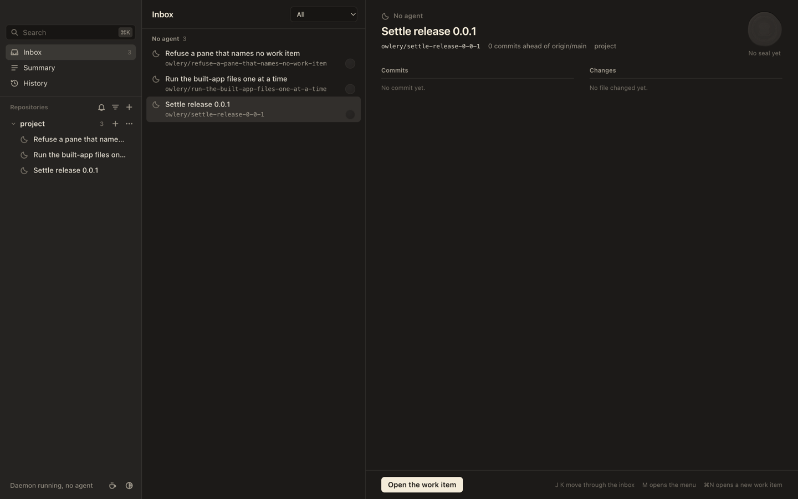
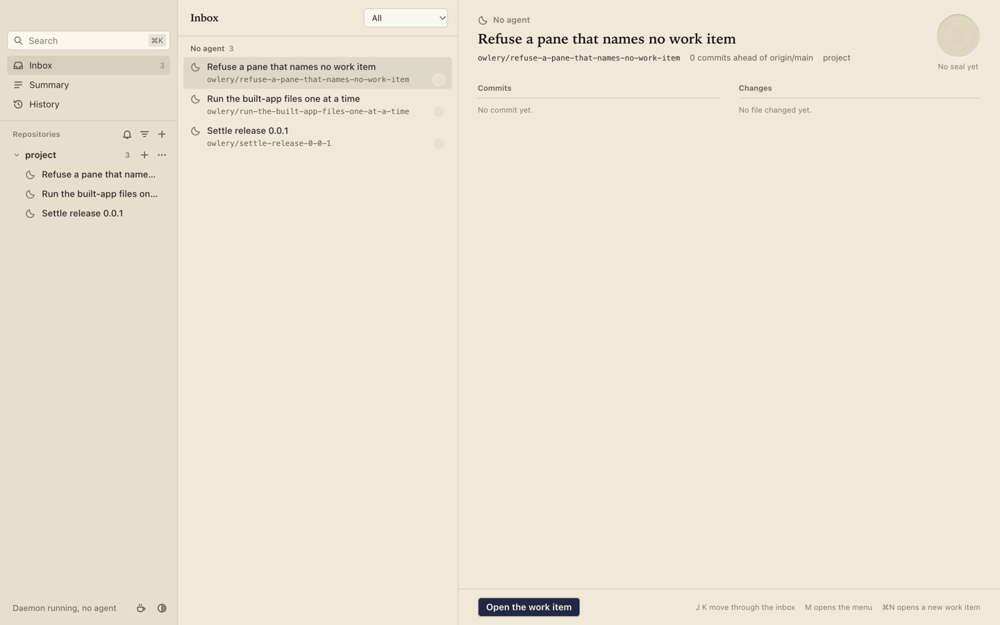
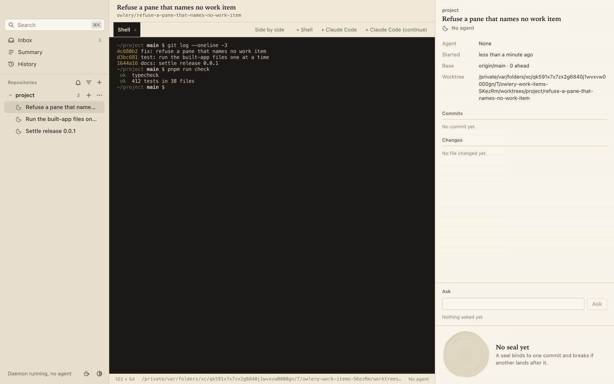
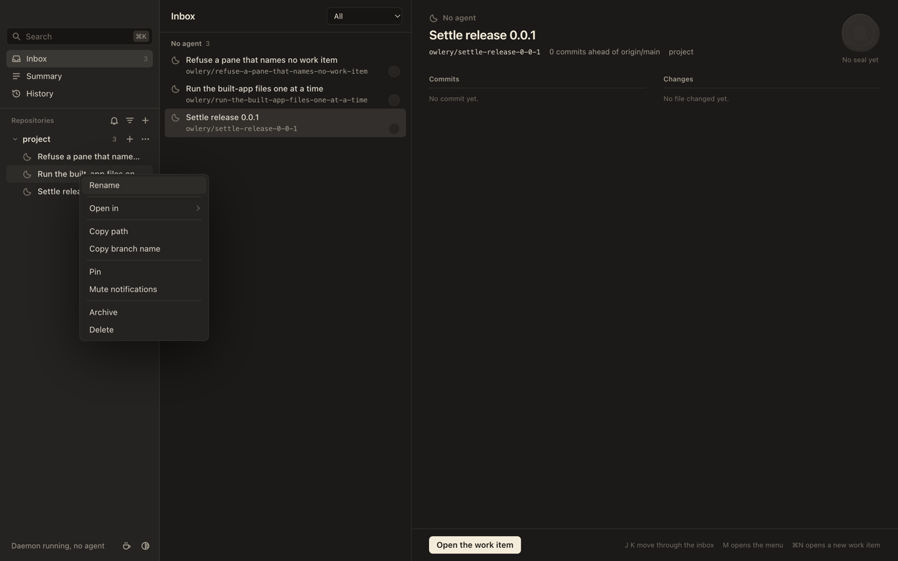
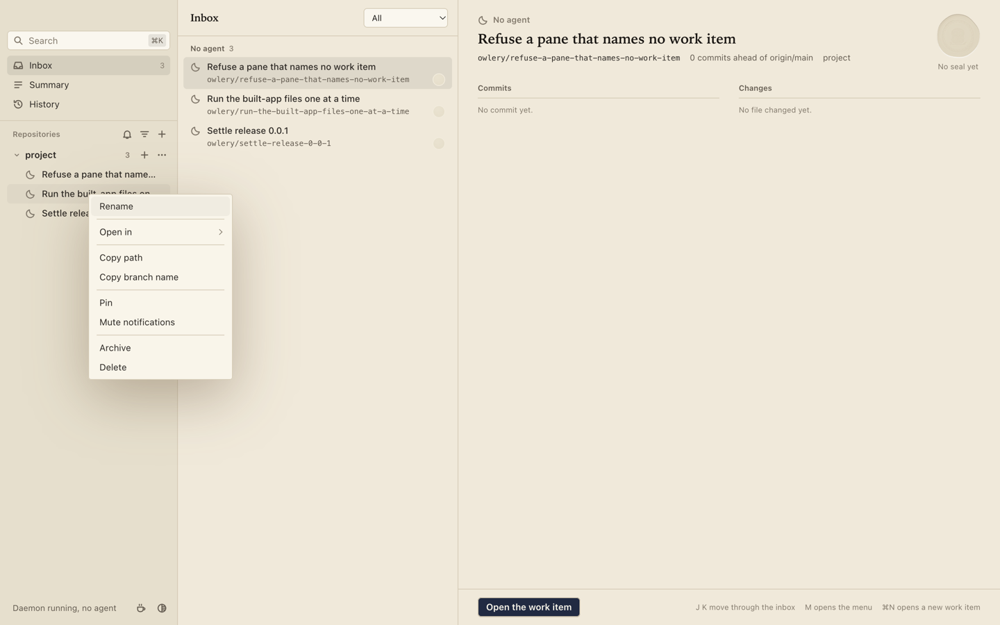
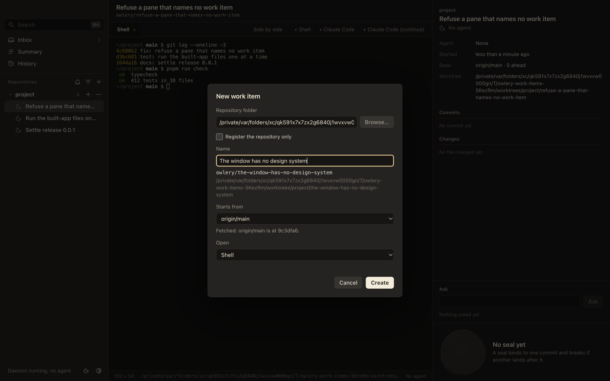
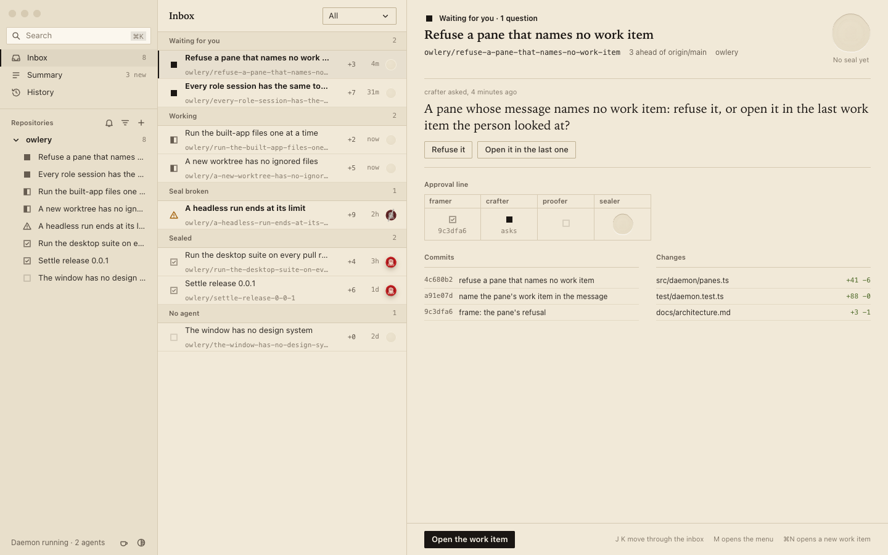
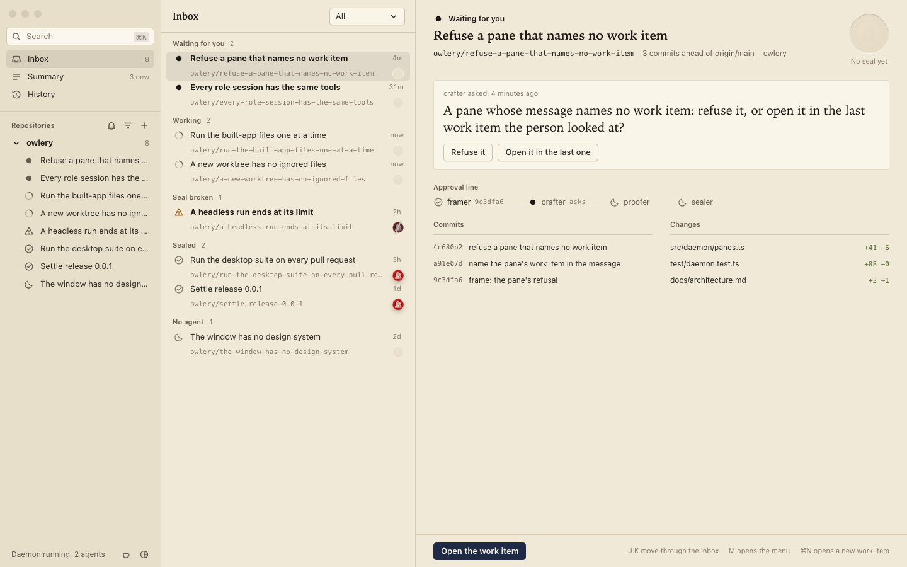
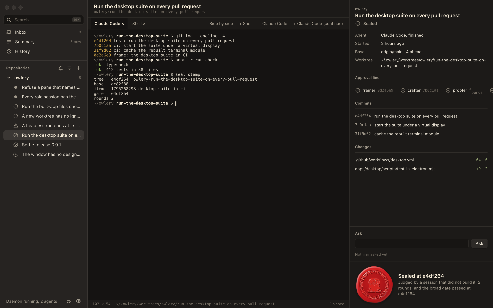
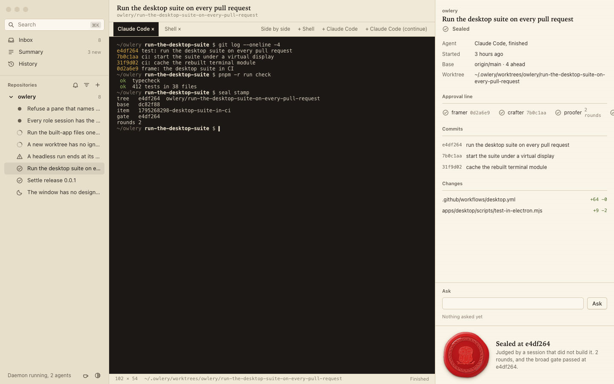

# Design: 1795340000-design-system, the study of directions

This file is the study issue #130 asks for first. It reads the window as it stands, names what to avoid, and puts three directions of Owlery's own style before the owner. The owner's choice is row Q1 of `questions.md`. The framer folds the answer into this frame before the first build spawn, and until then *Scope* items 2 to 7 are stated for any direction.

## Grounding

The tree as read at `0d65470`.

| Policy clause | What it fixes for this work |
|---|---|
| `docs/product.md` *The seal belongs to the product and looks the same everywhere*, last paragraph | A theme changes colours, typefaces, texture and how the seal is lit. No theme changes the layout, the words, the seal's drawing or the wax's red. Red stands on the seal alone, and a button, a mark and a failure take another colour. The window has two themes, Night desk and Letter. Every direction below keeps all of this. Read. |
| `docs/product.md` *Foundation* | The window opens on the inbox, a work item shows its state on one line, and the app stays light. A direction that needs a web typeface, an illustration set or a blur costs memory or disk the product does not spend. Read. |
| `docs/product.md` *The seal* | The seal shows in three places: an approval line per work item (framer, crafter, proofer, sealer), the seal on the pull request, and the back of the seal. The mock-ups draw the approval line and a lit seal from this clause. The app draws neither yet. Read. |
| `docs/product.md` *Who it is for* and *What we deliberately don't do* | The audience works in a terminal. The desktop has no chat screen, no kanban board, no built-in browser, no team screens, and the product makes no throughput claim. A chat bubble or a prompt box in the window would draw what the product refuses to be. Read. |
| `docs/name.md` *Why this name* and *What to keep in mind* | The emblem is a warm white owl on a black rounded square with no red. The owl on red wax is the seal, drawn at a seal's place and nowhere else. The window borrows no image from the Harry Potter books, such as an owl carrying a letter. Read. |
| `apps/desktop/src/renderer/themes.css` | Two blocks, `night-desk` and `letter`, each of 66 custom properties named by role. Executed: `awk '/^:root\[data-theme="night-desk"\]/{f=1} /^:root\[data-theme="letter"\]/{f=2} /^  --/{c[f]++} END{print c[1], c[2]}' apps/desktop/src/renderer/themes.css` printed `66 66`. The issue's count of 133 was not reproduced. |
| `apps/desktop/src/renderer/index.html` lines 10 to 63 | The layout's measures stand in the page's own `:root`: seven sizes of type from 11px to 34px, eleven steps of space from 2px to 44px, the heights and widths of the parts, and `--motion: 120ms`. No theme holds them. Read. |
| `apps/desktop/test/themes.test.ts` | Eight cases hold the look's rules as text: one block per theme, no red outside the properties that open `--seal-`, the same names in every block, no measure in a theme, and no colour, shadow, gradient or corner written outside a theme. A direction changes values and adds names, and these cases keep holding. Read. |
| `apps/desktop/src/renderer/shared.ts` line 193 | The mark of a work item that waits for the person is a speech mark, the outline of a chat bubble. Read. Each direction replaces it (*What to avoid*, item 3). |
| The earlier study of the window's finish, 2026-11-19, in the main clone's `etcs/design/polish-mockups/README.md`, not committed | It began from the owner's words that the window "looks like a prototype made with AI". It diagnosed the marks *What to avoid* item 6 lists and fixed them in four variants. Night desk as it stands holds variant 3's values and Letter holds variant 4's: the grounds `#1c1a18` and `#f1e9d8`, the inks, the radii 8, 6, 6, 4 and 4, 5, 5, 3. Read, the values compared with `themes.css` by eye. That study left two things open: where the emblem stands in the window, and whether a failure is ochre. The second is settled by the theme rule above. This study does not argue the choice of variants 3 and 4 again. Direction A changes the form of the parts, which variant 2 changed together with its ground, its red button, its serif titles and its larger sizes, so the choice against variant 2 does not say which of those the owner refused. Unverified, and the owner answers it in Q1. |
| The main clone's `etcs/research/brand.md`, not committed | It is the search for a personal brand's domain name, settled on Arizelos. It states nothing of colour, type or the window. Read: its headings whole, and a search for the words of colour, type, logo and theme. The study takes nothing from it. |
| The main clone's `etcs/research/competitors/orca.md`, `conductor.md`, `claude-code-desktop.md`, not committed | Each analyses what the product does, who runs it and what it costs. None describes the product's look. `conductor.md` records the market's view that Conductor's design and feel are the best of the field. Read by a search for the words of look and layout, not whole. The look of the nearest products is therefore read from their public pages, in the next row. |
| The public pages of the nearest products, opened 2026-11-22 | `https://www.orca.dev/`, `https://www.conductor.build/`, `https://linear.app/`, `https://cursor.com/` and `https://code.claude.com/docs/en/desktop`, five pages. Executed: one headless Chrome run each, `--headless=new --window-size=1440,2400 --screenshot`, and each capture read. The captures stand in the framer's scratch directory and are not committed, because they are other companies' pages. No product's app was installed or run, so what an app looks like past its own front page is unverified. |
| The window as it stands | Executed: a probe `test_tmp_shots.test.ts`, run once from a `git clone --no-local` of this branch in the framer's scratch directory with the main clone's installed modules linked in, through `apps/desktop/test/built-app.ts` with `OWLERY_BACKGROUND=1`. It built the app, created three work items in a temporary clone, and captured each screen with `Page.captureScreenshot` in both themes. The run exited 0. The captures *The window as it stands* shows are under `images/` as `as-is-*.png`, scaled to 1440 by 900. |
| Issue #130 | Its body is the request this study answers. It has no comment. Executed: `gh issue view 130 --json title,body,comments`. |
| `seal/threads/1795340000-design-system/routing.md` | Present. It routes the work through a framer, a crafter and the review chain, and names the choice of a direction as the one question for the owner. Read. |
| `seal/follow-up.md` | Absent. Executed: `ls seal/` lists `config.json`, `README.md` and `threads`. |
| The latest GitHub Release, `v0.0.1` | Its body holds no `### Process changes` heading. Executed: `gh release view --json tagName,body`. |
| Nothing in the tree takes a screenshot | Executed: `git grep -n captureScreenshot -- apps` at `0d65470` printed nothing. The search can fail: the probe's own file holds the word, in the scratch clone. |
| The page uses no blur | Executed: `git grep -n -c backdrop-filter -- apps/desktop/src` at `0d65470` exited 1 and printed nothing. |

## The window as it stands

| Screen | Night desk | Letter |
|---|---|---|
| The inbox |  |  |
| A work item's view |  |  |
| A work item's menu |  |  |
| A dialog |  |  |

What the captures show, read against the policy above.

- **What already is Owlery's own.** The seal's place is pressed blank into the ground before a seal, at the right of each line, in the preview and at the foot of a view. The words are whole sentences that say what will happen and name the thing: "A delete removes the work item's worktree and its local branch", "Nothing on a remote is removed", "A seal binds to one commit and breaks if another lands after it". The hints name keys in a sentence: "J K move through the inbox". No red stands anywhere but the seal.
- **What is nobody's choice.** A line, a menu's item and a sidebar's item are each a rounded tile that fills on hover, the form most desktop tools of 2026 share. A menu and a dialog are a rounded card with a wide soft shadow. A button is a rounded tile. None of these forms is stated anywhere, so each work item drew its own.
- **Where the window sits beside its neighbours.** Night desk is a warm brown-black with cream ink, and Letter sets its titles in a serif on cream paper. The Claude Code documentation page and Cursor's front page, opened for this study, draw on the same warm dark ground with cream ink, and Claude's page sets its titles in a serif. Without the seal on screen, the window's ground and ink are theirs.
- **What an empty work item shows.** No work item can be sealed yet, so every seal's place is blank and every state in the captures is "No agent". The mock-ups below fill the states that `docs/product.md` names, so a direction is judged on the screen a person will use.

## What to avoid

### The marks of a generic AI product

1. **Purple, and gradients of purple into blue or pink.** A violet glow behind a panel, a gradient across a headline or a button. Owlery's only saturated colour is the wax's red, and it stands on the seal alone.
2. **Sparkles.** A four-pointed star beside a word to say that a model does it. The Claude Code documentation page carries one on its "Ask Assistant" button (opened 2026-11-22). Owlery marks nothing as made by a model: every line of the inbox is an agent's work, so the mark would say nothing.
3. **Chat bubbles and the prompt box.** A transcript of rounded bubbles over a box that says "Ask anything", with a model's name on a chip under it. Orca's, Conductor's and Cursor's front pages each show their app as that screen (opened 2026-11-22). `docs/product.md` refuses a chat screen on the desktop. The window's own mark for a wait is a speech mark today (`apps/desktop/src/renderer/shared.ts` line 193), and every direction below replaces it.
4. **Glass.** A translucent panel that blurs what is behind it. The page uses no blur today, and a direction adds none: a blur costs the graphics process memory the product measures.
5. **Rounded everything.** Buttons and fields as full pills, cards with corners of 12px and more, round avatars. Linear's "Sign up" and Cursor's download buttons are pills (opened 2026-11-22). A direction states one small scale of corners and uses a circle only for what is round in the world: the seal and a state's mark.
6. **The eight marks the study of 2026-11-19 diagnosed in this window.** A blue slate ground with amber and sky accents. Inter, Space Grotesk and JetBrains Mono. Labels in tracked capitals. A 30px title over 68px lines and 44px buttons. An empty preview. One radius of 8px and one 1px edge on everything, with a dashed circle for the seal. A logo's row of its own under the traffic lights. No hover, no motion, no icon of a state. The window as it stands has none of them, and `docs/design.md` names them so that none returns.
7. **Words that sell.** "Magic", "supercharge", "100x", an exclamation mark, a greeting from the agent in the first person, an emoji in a label. Orca's front page opens with "Ship 100x with the agent IDE" (opened 2026-11-22), and `docs/product.md` refuses throughput claims.

### The patterns of the nearest products

What each page showed on 2026-11-22. Each row names the pattern to stay clear of, and a row says so where the pattern is close to what the window draws today.

| Product | Source | What its page draws | What Owlery does not take |
|---|---|---|---|
| Orca | `https://www.orca.dev/` | A cool near-black ground, a white grotesque headline, a strip of pill tabs. The app is a tree of worktrees with each agent's logo on its row, split panes of chat with a prompt box in each, and a status bar of usage meters. | The agents' brand logos as row icons, the prompt box, the bar of meters, the claim of speed. |
| Conductor | `https://www.conductor.build/` | A black ground under a field of pixel stars and ASCII figures, and a pixel logo. The app is a sidebar of workspaces, a chat transcript in the middle, and a right column of changed files with green and red counts under a green "Merge" button. Team members' round photographs stand in the sidebar. | The decoration of pixels and ASCII, the green button of a merge, photographs of people. Its right column of commits and changed files is close to the window's own, so the window's column is told apart by the approval line and the seal at its foot. |
| Linear | `https://linear.app/` | A near-black neutral ground, a tight grotesque, a headline whose first sentence is white and whose rest is grey, captions in tracked fixed-width capitals ("FIG 0.1"), figures drawn as isometric hairlines. | The two-tone headline, the tracked capitals, the hairline figures. The look of Linear's app itself was not opened. Unverified. |
| Cursor | `https://cursor.com/` | A warm near-black with cream ink, the app's windows floating over an oil painting of a landscape, an orange for links, pill buttons. | The painting behind a window, the orange. Its warm ground and cream ink are close to Night desk's. |
| Claude Code's desktop app | `https://code.claude.com/docs/en/desktop` | The documentation page: a warm dark ground, page titles in a serif, a terracotta orange for the active item and the eyebrow over a title, the spark logo, a sparkle on "Ask Assistant". The app itself was not opened. Unverified. | The orange, the spark, the sparkle. Its serif titles on a warm ground are close to Letter's serif titles and to the serif of what an agent says in both themes. |

The neighbours fall into two camps. Orca, Conductor and Linear draw in neutral black with a grotesque. Cursor and Claude draw in warm black with cream, and Claude adds a serif. Night desk and Letter stand in the second camp today. No page opened draws a ruled register, an approval line, or a seal.

## The directions

The directions change different things. A changes the form of the parts and keeps the themes' colours. B changes the colours and the marks and keeps the form. C keeps both and writes down what stands. Each keeps the layout, the sizes of type, the system's typefaces, the two themes' names, the seal's drawing and its red, a failure that is not red, and the sentences the window says. Each replaces the speech mark of a wait.

Each mock-up is `images/mock.html` drawn by a headless Chrome, with the layout's measures of the built app. Open it from a checkout as `mock.html?d=<register|watch|desk>&t=<night-desk|letter>&s=<inbox|view>` to see a direction at the screen's own sharpness. The Night desk images are drawn at twice the size and the Letter images at the size itself. The work items, commits and terminal lines in it are invented examples. The approval line and the lit seal are drawn from `docs/product.md` *The seal* before the app can show them. The broken seal is a placeholder and no proposal: its drawing belongs to the milestone that builds the seal.

### A. Register

**The idea: the window is the register where sealed work is entered, so it is drawn as a ruled book of records and the seal is the one thing on it that is not ink.**

| | Night desk | Letter |
|---|---|---|
| The inbox |  |  |
| A work item's view |  |  |

| | Register |
|---|---|
| Keeps of the brand and the themes | Every colour of Night desk and Letter as it stands, the serif for what an agent says and for the summary's sentence, Letter's serif titles and its ruled paper, the blank seal pressed into the ground. |
| Changes | The form of every part: corners, edges, the selected state, the columns of a line, the marks of a state, the approval line. |
| Palette | The themes' own. Two rules grow stronger in Night desk, `--rule` from 9% to 13% of the cream and `--rule-soft` from 5% to 7%, because the rules now carry the structure. Letter's main button turns from ink blue `#1f2a44` to the ink `#1a1613`, so a page holds one ink. |
| Type | The system's sans for words. The system's fixed-width face, with figures of one width, for every fact a person compares down a column: a branch, a commit, a count of commits ahead, an age, a count of a group. The serif where the themes have it. |
| Space | The layout's steps as they stand. A line spans the list's whole width and is divided from the next by a rule, so the list reads down its columns. |
| Radius | 0 for a line, a group's head and a chip. 2px for a button, a field, a menu and a dialog. A circle for the seal alone. |
| Motion | None on hover: the ground changes at once. 120ms on a press. The half-filled mark of work alternates its filled half once a second, in a step. A seal's arrival is the one drawn motion: the wax is pressed in over 240ms, once, and under the system's setting for less motion it appears. |
| Texture | Rules. A group's head is a ruled band on the sidebar's ground. Letter keeps its paper. No shadow under a line, a button or a card; a menu and a dialog keep one, because they stand over the page. |
| The seal and the owl | A line ends in a seal's column, so the seals of the inbox stand under one another like the stamps down a register's margin. The approval line is a ruled block of four boxes, one for each of framer, crafter, proofer and sealer. A stage that is done leaves a ticked box and the commit or the count of rounds it left. The sealer's box holds the seal: blank and pressed before, the wax after. The owl appears in the seal and nowhere else. |
| Marks of a state | Boxes, as a form has them. A filled box waits for the person, a half-filled box is at work, a ticked box is finished, an empty box has no agent, and the ochre triangle is a failure or a broken seal. |
| Selected | A rule of the strong ink, 2px, at the left edge of the line, and a faint ground. |
| Voice | The record's. A fact is a field and its value: "tree e4df264 · gate e4df264 · rounds 2", "3 ahead of origin/main", "Waiting for you · 1 question". A sentence stays where the window explains or warns, as the delete dialog does today. |
| What it costs | A line's title loses about 66px of its width to the two new columns at the list's width of 404px, so more titles are cut short in the list. The window reads colder than it does today, and the serif of what an agent says is what keeps it from reading as a spreadsheet. |
| Who else draws this | None of the pages opened. A ruled table is common in tools of data, and what makes this one Owlery's is the seals' column and the approval block. |

### B. Night watch

**The idea: the window is drawn from the emblem, a white owl on black, and the owl's yellow eye is the one colour that says a work item needs the person.**

| | Night desk | Letter |
|---|---|---|
| The inbox |  |  |
| A work item's view |  |  |

| | Night watch |
|---|---|
| Keeps of the brand and the themes | The emblem's two colours as the window's ground and ink. The themes' names, the form of every part as it stands (a line as a rounded tile, the radii 8, 6, 6, 4), the blank seal. |
| Changes | Every colour of both themes, the marks of a state, and the serif, which goes. |
| Palette | Night desk: grounds `#0f0f10`, `#161617` for the sidebar and `#1c1c1e` raised, from the icon's black (`#1a1a1a` to `#050505`); inks `#f3efe6`, the icon's owl, then `#dcd9d1`, `#9a978f`, `#6b6963`. Letter: the same two turned over, ground `#f3efe6` and ink `#0f0f10`. One signal colour, the eye's yellow: `#f2c033` on black, and on the light ground `#8a6400` for words over a fill of `#e9b61a`. It stands on what needs the person: a waiting mark, the edge of a question, a failure. Its red exceeds its green by 50 of 255, inside the margin of 80 under which `themes.test.ts` reads no red. |
| Type | The system's sans alone, and the fixed-width face for a branch and a commit. No serif: what an agent says is set in the sans at 20px, medium. |
| Space | The layout's steps as they stand. |
| Radius | As it stands in Night desk: 8, 6, 6, 4, in both themes. Letter gives up its own smaller scale. |
| Motion | 160ms on hover and press. The ring of work turns. A waiting mark closes and opens once when it arrives, a blink of 120ms, and never again. |
| Texture | None. Depth is the three blacks. Letter gives up its ruled paper. |
| The seal and the owl | The seal as it stands, and its red is the only warm colour on a neutral page, so it reads from across the room. The owl appears a second time, as the marks of a state: an open eye with its pupil waits for the person, a closed eye is finished, and a crescent moon has no agent. |
| Marks of a state | The open eye in the signal colour, the turning ring, the closed eye, the crescent, and a filled triangle in the signal colour for a failure or a broken seal. |
| Selected | A tinted tile, as it stands. |
| Voice | The night's, said to the person: "Needs you", "Asleep" for a work item with no agent, "2 agents awake" in the sidebar's foot. Sentences stay as they stand where the window explains or warns. |
| What it costs | It overturns the grounds and inks the owner chose on 2026-11-19. Yellow is the colour most tools use for a warning, so a waiting work item may read as a fault, and a failure and a wait share the colour and differ by shape alone. The names of the night are close to cute, and "Asleep" says less than "No agent" to a person who reads it the first time. |
| Who else draws this | The neutral black ground with a grotesque is the camp of Orca, Conductor and Linear. The eye's yellow and the eye marks are on none of the pages opened. |

### C. Desk

**The idea: the window is right as it stands, a warm desk at night and a sheet of letter paper, and the work is to write it down and fix the one mark that is a chat bubble.**

| | Night desk | Letter |
|---|---|---|
| The inbox |  |  |
| A work item's view |  |  |

| | Desk |
|---|---|
| Keeps of the brand and the themes | Everything: both themes' colours, typefaces, texture, radii, and the form of every part. |
| Changes | The mark of a wait, from the speech mark to a filled disc in the strong ink. The approval line arrives as a row of the roles' names, each with its mark, joined by short rules. |
| Palette | `themes.css` as it stands. |
| Type | The system's sans, the fixed-width face for a branch and a commit, the serif for what an agent says, the summary's sentence and Letter's titles. |
| Space | The layout's steps as they stand. |
| Radius | Night desk 8, 6, 6, 4. Letter 4, 5, 5, 3. |
| Motion | 120ms on hover and press, and the turning ring of work, as they stand. |
| Texture | None in Night desk, the ruled paper in Letter's right column. |
| The seal and the owl | As they stand: the blank place pressed into the ground, the wax where a work item is sealed, and the owl nowhere else. |
| Marks of a state | A filled disc, the turning ring, a ticked circle, the crescent, the ochre triangle. |
| Selected | A tinted tile. |
| Voice | The window's own as it stands: whole sentences that say what happens and name the thing. |
| What it costs | The least to build. The window stays the nearest of the directions to Claude's and Cursor's pages: a warm dark ground, cream ink, and in Letter a serif title. Where no seal is on screen, nothing drawn says the window is Owlery. |
| Who else draws this | The warm ground and cream ink: Cursor and Claude. The serif titles: Claude. The rounded tiles: every page opened. |

### The framer's recommendation

Direction A, Register. The grounds, for the owner to overturn by opening what this study opened.

1. It keeps what the owner chose on 2026-11-19, the colours and typefaces of Night desk and Letter, and changes what nobody has chosen yet, the form of the parts.
2. What makes it Owlery's comes from the product's own things: the record, the approval line and the seal. None of the pages opened draws any of them, so the difference does not rest on a colour another product can pick tomorrow.
3. It holds in both themes and in any theme added later, because a theme changes colour and the register is form.
4. Its cost is known and bounded: narrower titles in the list. B's cost is a signal colour that reads as a warning, and C's is that the window stays in Claude's and Cursor's camp.

## Scope

In scope, by number. `frame/plan.md` cites these numbers.

1. **The study.** This document, its screenshots and its mock-ups under `images/`. It is done at the frame.
2. **`docs/design.md` and `docs/design.ko.md`.** The chosen direction's principles; its tokens of colour, type, space, radius and motion, each with its value in each theme; its components and their states (a button, a line of the inbox and of the sidebar, a group's head, a menu, a dialog, a field, a tab, a state's mark, the seal's place, the approval line; and for each the resting, hover, pressed, selected, focused and disabled states it has); the voice of the window's words; and what to avoid, from *What to avoid* above. `README.md` and `README.ko.md` gain the document's row in their table of documents.
3. **The tokens have one source.** Every property of a theme's block in `themes.css`, and every measure of the page's `:root` in `index.html`, is a token `docs/design.md` names with that value, in both editions, and a case of the suite fails where they differ.
4. **The components and states of the chosen direction are drawn.** `index.html`, `themes.css` and the renderer's modules draw each component of item 2 as the document states it, in both themes.
5. **The mark of a wait is no speech mark.** `apps/desktop/src/renderer/shared.ts#STATE_SHAPES` draws the chosen direction's mark for `waiting`.
6. **The window's words follow the voice.** Each word the chosen direction changes is changed, and a case pins each new text.
7. **The screenshot step.** One command of `apps/desktop` writes the screenshots of the inbox, a work item's view, a menu and a dialog in both themes, through `apps/desktop/test/built-app.ts`. `docs/design.md` states that a pull request that changes the window carries the screenshots of the views it changed, in both themes, and that its review reads them against the document. This pull request carries its own.

Out of scope, each with its reason.

- **The layout.** The columns, their order and the sidebar's items were chosen in issue #18, and a theme and a direction change none of them.
- **A third theme, or new names for the two.** `docs/product.md` names Night desk and Letter.
- **The seal's drawing, the wax's red, and the drawing of a broken seal.** The first two are AgenticSeal's and policy fixes them. The third belongs to the milestone that builds the seal.
- **The approval line and a lit seal in the app.** No work item can be sealed yet. `docs/design.md` states their form, and the milestone that builds the seal draws them.
- **A web typeface, an illustration, a blur.** Each costs what `docs/product.md` *Foundation* says the app does not spend.
- **The app's icon, the README's emblem, the phone, a website.** The issue asks for the window.

## User scenarios & acceptance *(mandatory)*

| Scenario | Given / When / Then | Verifiable how |
|---|---|---|
| The owner chooses | Given this study. When the owner reads the directions and their mock-ups. Then the owner names one, and no other question of this issue waits on the owner. | `frame/questions.md` row Q1 holds `answered <date> by <who>` in its Status cell, and no other row names a person. |
| A person reads the system | Given the chosen direction. When a person opens `docs/design.md` or `docs/design.ko.md`. Then it states the principles, the tokens with their values in each theme, the components with their states, the voice, and what to avoid. | Both files exist with the same count of headings and of table rows, which the `Broad gate` command of `seal/config.json` checks for every document of `docs/`. The orchestrator runs it. |
| A theme's value drifts from the document | Given `docs/design.md` names a token's value. When `themes.css` or the page's `:root` holds another value, or a property the document does not name. Then a case of the suite fails and names the token. | A case in `apps/desktop/test/themes.test.ts`, seen red with one value of `themes.css` changed. |
| A wait is no chat bubble | Given a work item that waits for the person. When the inbox draws its line. Then its mark is the chosen direction's and not a speech mark. | A case of `apps/desktop/test/view.test.ts` on the shape `STATE_SHAPES` gives `waiting`, seen red against the speech mark's path. |
| Red stands on the seal alone | Given the chosen direction's colours. When the suite reads `themes.css`. Then no property outside the ones that open `--seal-` holds a red. | The existing case "holds a red in no property but the seal's" of `apps/desktop/test/themes.test.ts`. |
| A pull request that changes the window shows it | Given a branch that changes a view. When its builder runs the screenshot command. Then a PNG file is written for each screen *Scope* item 7 names in each theme, and the pull request's body shows the ones of the views it changed. | The command exits 0 and writes those files, and this work item's own pull request body shows them. |

## Data & interfaces

- `docs/design.md` and `docs/design.ko.md`: new policy documents. The token tables are what *Scope* item 3's case reads, so their columns are the token's name, its value in Night desk and its value in Letter, and for a measure of the layout its one value.
- `apps/desktop/src/renderer/themes.css`: the values of the chosen direction, and the names it adds. The file's opening comment keeps saying what a block holds and points to `docs/design.md` for the values' source.
- `apps/desktop/src/renderer/index.html`: the forms of the components, and the page's `:root` measures where the direction changes one.
- `apps/desktop/src/renderer/shared.ts#STATE_SHAPES`: the marks of a state.
- `apps/desktop/package.json`: one script that runs the screenshot case, beside `korean:typed`, `measure:memory` and `role:run`, which are runs of one test file under a variable of the environment.
- `images/mock.html` of this work item: the mock-ups' source, which holds each direction's values as custom properties under `:root[data-d="…"]`. The build reads the chosen direction's values there.

## Rule changes

- nothing
  why: The work item's subject is the policy root: it adds `docs/design.md` and `docs/design.ko.md`, and its pull request writes them directly. It changes no sentence of `docs/product.md` or `docs/name.md`, whose rules of the themes, the seal and the emblem every direction keeps.

## Removes

| Removes | Coordinate | Where it lands, or why it can go |
|---|---|---|
| The speech mark as the mark of a wait | `apps/desktop/src/renderer/shared.ts#STATE_SHAPES`, the `waiting` shape, and the comment over it that names "a speech mark for a wait" | The chosen direction's mark replaces it. A chat bubble says a chat, which the desktop does not have. |
| The values of the two themes the chosen direction changes | `apps/desktop/src/renderer/themes.css`, the blocks `night-desk` and `letter` | `docs/design.md` states each new value, and the block follows it. Under direction C no value goes. |

The screenshot step adds a rule and a command, and takes no mechanism out in return. What it replaces is the owner's check of each change by hand, which is no file of the tree, so nothing in the tree can go for it.

Framed 2026-11-22 by framer, before the build.
